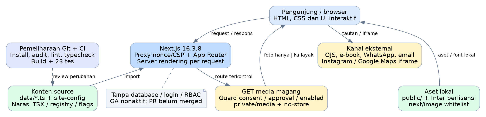
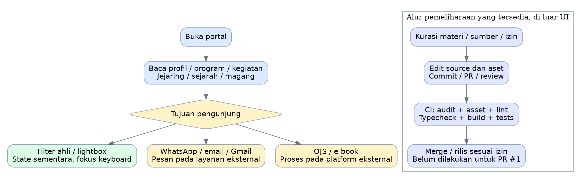
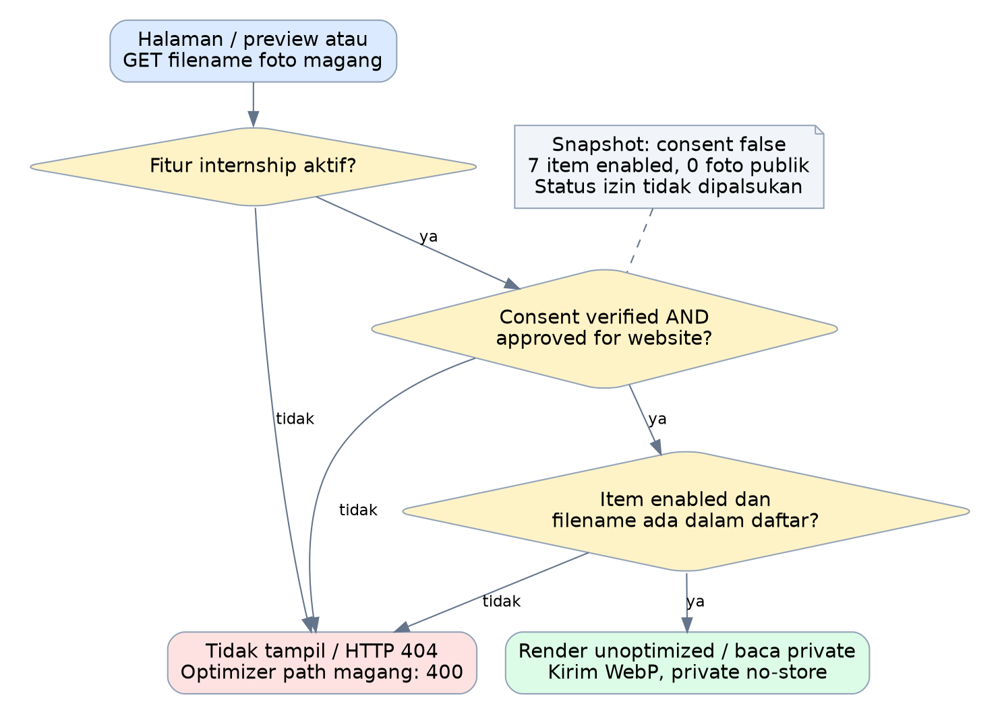
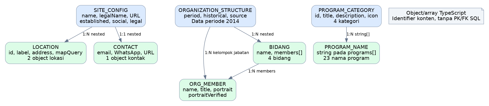
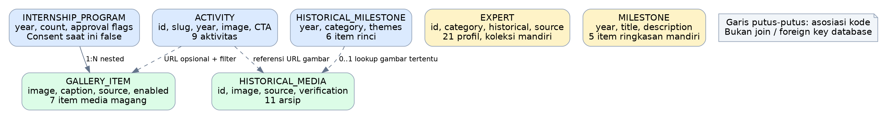
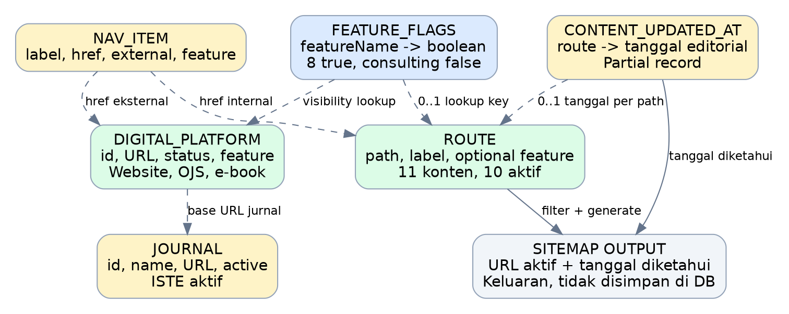

# 1. Ringkasan eksekutif

**P4I Corporate Hub merupakan portal informasi kelembagaan Pusat Pendidikan dan Penelitian Pembangunan Indonesia.** Portal menampilkan profil lembaga, kapabilitas/program, publikasi, kegiatan, arsip sejarah, jejaring keahlian, informasi magang, alamat, dan kanal komunikasi. Proses jurnal serta e-book berlangsung pada platform eksternal.

Laporan terbaru ini menggunakan implementasi setelah perbaikan temuan A01–A16 pada commit **`f77e0f8795e56ed8701cd0751d5d20c3ff2c6431`**, branch **`fix/corporate-hub-audit`**. Perbaikan masih berada dalam **draft PR #1**, belum digabungkan ke `main`. Karena itu, uraian kondisi sesudah perbaikan tidak otomatis menjadi keadaan domain produksi yang memakai `main`.

Aplikasi memakai Next.js App Router, React, TypeScript, Tailwind CSS, data pada source repository, dan aset lokal. Halaman HTML sekarang dirender di server per request untuk mendukung CSP dengan nonce. Tidak ditemukan database, autentikasi pengguna, RBAC, dashboard admin, CMS, pembayaran, maupun penyimpanan pendaftaran/pesan dalam Corporate Hub. Ada satu endpoint server untuk penyajian media magang secara terkendali; endpoint tersebut bukan API transaksi bisnis.

Hasil pemeriksaan: **23 tes Playwright lulus**, pemeriksaan **20 referensi aset** lulus, lint **55 berkas** lulus, typecheck strict dan build berhasil, serta **CI GitHub berhasil** pada commit yang sama. Audit npm yang diulang untuk laporan ini melaporkan **0 advisory**, termasuk dependensi development.

Perubahan yang paling berpengaruh: foto magang yang belum mendapat verifikasi consent tidak tampil dan tidak dapat diunduh melalui endpoint aplikasi; GA dinonaktifkan; kontrol fitur mengikuti halaman/menu/sitemap; dialog dapat dioperasikan dengan keyboard; sumber/periode profil ahli diperjelas; font tersedia lokal. Konsultasi mempunyai isi ketika diaktifkan tetapi flag default tetap false.

Dokumen ini melaporkan sistem yang ada dan hasil perbaikannya. **Tahap rekomendasi pengembangan belum dilaksanakan dan tidak dimasukkan sebagai desain baru dalam laporan ini.**

# 2. Identitas, sumber bukti, dan batas pemeriksaan

| Elemen | Kondisi terkonfirmasi |
|---|---|
| Repository | `HannR002/p4i-corporate-hub` |
| Snapshot utama laporan | `f77e0f8795e56ed8701cd0751d5d20c3ff2c6431` |
| Branch snapshot | `fix/corporate-hub-audit` |
| Baseline / remote main | `2e6ae709edaa1e21b4b71d15c7f8d43431296f57` |
| PR perbaikan | [PR #1](https://github.com/HannR002/p4i-corporate-hub/pull/1), OPEN, draft, belum merged saat pemeriksaan |
| CI | [Repository checks](https://github.com/HannR002/p4i-corporate-hub/actions/runs/37880480616), completed/success, SHA sama |
| Tanggal laporan | 9 Oktober 2026, UTC |
| Skala snapshot | 131 berkas tracked; 49 source aplikasi/tes; 4.768 baris pada source terhitung |
| Ruang penghitungan source | TS/TSX/JS/MJS/CSS di `app`, `data`, `lib`, `scripts`, dan `tests`; root config dan dokumen tidak dihitung sebagai source aplikasi |
| Metode | Inspeksi kode/config/lockfile; inventaris otomatis; pembacaan status PR/log CI; audit npm terkini; bukti pengujian sebelumnya pada SHA yang sama |

Hasil tes dan build berasal dari verifikasi lokal setelah perbaikan serta CI tanggal 9 Oktober 2026. Log CI mengonfirmasi 23 tes lulus, pemeriksaan aset/lint, dan audit dependency. Suite penuh tidak dijalankan ulang hanya untuk menggandakan bukti pada kode yang sama; audit npm diulang karena advisories dapat berubah tanpa perubahan source.

Status deployment Vercel **Preview** pada PR dilaporkan berhasil oleh integrasi GitHub. Status tersebut tidak disamakan dengan pengujian fungsional domain produksi. Laporan tidak mengklaim konfigurasi hosting, TLS, cache lama, akun GA, data OJS/e-book, bukti izin foto, atau kredensial profesional telah diaudit langsung.

# 3. Tujuan, konteks, dan cakupan sistem

## 3.1 Tujuan operasional yang terlihat

Portal mengomunikasikan identitas dan riwayat P4I, membantu pengunjung memahami bidang keahlian/program, menyajikan dokumentasi historis, dan mengarahkan pengunjung ke kanal publikasi atau komunikasi yang relevan. Identitas pada konfigurasi adalah Yayasan Pusat Pendidikan dan Penelitian Pembangunan Indonesia, dengan tanggal pendirian yang ditampilkan 12 Mei 2014.

Konfigurasi mencantumkan kantor pusat Bogor dan kantor cabang Jambi, email `admin@p4ijournal.org`, WhatsApp, serta Instagram `p4i.official`. Nilai ini adalah informasi yang ditemukan pada source; laporan tidak mengesahkan dokumen legal atau status kantor di lapangan. Rincian legal seperti akta/SK masih kosong dan `legal.enabled` false.

## 3.2 Batas Corporate Hub dan ekosistem

| Proses | Dikerjakan Corporate Hub | Lokasi proses lanjutan |
|---|---|---|
| Profil/program/kegiatan/arsip | Rendering informasi dari repository | Hub |
| Jejaring keahlian | Menampilkan kartu, label sumber/periode, filter kategori | Hub |
| Informasi magang | Informasi program dan kontrol publikasi dokumentasi | Hub; komunikasi lewat kanal eksternal |
| Pesan kepada P4I | Membuka WhatsApp, mailto, atau Gmail dengan teks awal | Aplikasi WhatsApp/email; tidak disimpan oleh Hub |
| Artikel jurnal | Menautkan kanal jurnal OJS | `journal.p4ijournal.org` |
| Katalog literatur/e-book | Menautkan kanal e-book | `publisher.p4ijournal.org` |
| Akun penulis/reviewer/editor | Tidak dikelola oleh Hub | Kemampuan/konfigurasi aktual OJS tidak diaudit di repository ini |
| Transaksi, pembayaran, pendaftaran | Tidak diimplementasikan | Tidak ada proses tersebut pada source Hub |

Penyebutan suatu program historis, ahli, atau institusi bukan bukti bahwa layanan sedang tersedia, semua personelnya merupakan pegawai aktif, atau suatu kerja sama sedang berjalan.

# 4. Arsitektur dan struktur sistem



## 4.1 Lapisan arsitektur

| Lapisan | Implementasi | Fungsi |
|---|---|---|
| Presentasi | `app/**/page.tsx`, layout, komponen React, Tailwind | Halaman, navigasi, dialog, kartu, galeri, kontak |
| Kebijakan aplikasi | `lib/routes.ts`, `features.ts`, `require-route.ts`, media-publication | Visibilitas route/fitur dan kelayakan publikasi media |
| Konten/config | `data/*.ts`, `lib/site-config.ts`, sebagian narasi TSX | Data institusi, program, arsip, publikasi, profil, tanggal konten |
| Server request | `proxy.ts`, root layout async, route media Node.js | Nonce/CSP, redirect jurnal, rendering HTML, akses media |
| Aset | `public`, font lokal, media di `private` | Logo, arsip, font, foto yang dikendalikan endpoint |
| Validasi | scripts, Biome, TypeScript, Playwright, GitHub Actions | Aset, mutu source, build, policy dan perilaku browser |
| Integrasi | Tautan eksternal dan Google Maps iframe | Publikasi dan komunikasi di layanan lain |

Next.js berfungsi sebagai frontend sekaligus server rendering dan handler media. Tidak ada backend terpisah atau service database yang ditemukan. Server Components membaca konstanta/data source, bukan query database.

## 4.2 Rendering dan batas client

Root layout memanggil `headers()` untuk mengambil nonce per request. Akibatnya halaman HTML memiliki kebutuhan server rendering dinamis. Data tetap berasal dari source statis; **data statis tidak berarti seluruh halaman menjadi berkas HTML static generation**. Sitemap, robots, icon, dan gambar Open Graph dapat menjadi keluaran metadata statis menurut build yang diverifikasi.

Komponen interaktif yang memakai `use client` adalah Navbar, ContactLauncher, ExpertCarousel, ArchiveMediaButton, dan Lightbox. Beranda, rekam jejak, PageHero, Footer, serta struktur organisasi tetap berada pada jalur server. State UI bersifat sementara di browser dan tidak mempunyai tabel penyimpanan.

Font Inter 4.1 dibundel melalui `next/font/local`; lisensi SIL OFL disertakan. `next/image` digunakan pada aset yang diizinkan optimizer. Media magang memakai jalur server dengan `unoptimized` agar optimizer tidak membuat cache yang melewati guard.

# 5. Bahasa, framework, library, dan runtime

| Teknologi | Versi pada snapshot | Penggunaan |
|---|---|---|
| TypeScript / TSX | 7.0.2; strict true | Model konten, logic, komponen React |
| Next.js | 16.3.8 | App Router, rendering, metadata, proxy, image/OG, route handler |
| React / React DOM | deklarasi `^19.2.8`; lockfile menjadi acuan install | UI dan state interaktif |
| Tailwind CSS | 4.3.3 | Utility styling dan responsivitas |
| PostCSS / plugin Tailwind | 8.5.29 / 4.3.3 | Pemrosesan CSS |
| Sharp | 0.35.5, dependensi langsung | Helper logo dan dukungan pengolahan gambar |
| Lucide React / React Icons | deklarasi `^1.30.0` / `^5.7.0` | Ikon UI |
| Biome | 2.5.15 | Lint source/config |
| Playwright Test | 1.64.0 | Policy tests dan pengujian browser Chromium |
| Node.js / npm | engines Node 24, npm 11; `.nvmrc` 24.19.0 | Runtime dan manajemen paket |
| JavaScript / MJS | Helper/config | Logo, pemeriksaan aset, konfigurasi build |
| CSS / JSON / YAML | Source/config | Styles, manifest/lockfile, workflow CI |

Berkas dengan `^` menyatakan rentang dependency, bukan jaminan versi install berikutnya tanpa lockfile. Versi terpasang pada pemeriksaan dapat dilihat di `bukti/versi-dependensi.json`. Install reproducible menggunakan `npm ci`.

Inventaris source: 25 berkas `.ts`, 21 `.tsx`, serta masing-masing satu `.css`, `.mjs`, dan `.js` pada ruang hitung aplikasi/tes. Library GA, Framer Motion, dan Next Themes sudah dilepas dari dependency aplikasi. Tailwind 4 membutuhkan browser modern: Chrome 111+, Safari 16.4+, atau Firefox 128+.

# 6. Struktur folder dan tanggung jawab kode

```text
p4i-corporate-hub/
  app/
    layout.tsx, page.tsx, globals.css
    tentang/, program/, publisher/
    rekam-jejak/, kegiatan/, magang/, kontak/
    kebijakan-privasi/, syarat-ketentuan/
    layanan/konsultasi/
    archive/p4i/magang/[filename]/route.ts
    components/
      layout/       Navbar, Footer, PageHero
      contact/      ContactLauncher
      experts/      ExpertCarousel
      organization/ OrganizationChart
      ui/           ArchiveMediaButton, Lightbox
    sitemap.ts, robots.ts, opengraph-image.tsx, icon.png
  data/             12 modul konten/registry/tanggal
  lib/              8 modul config, visibility, metadata, security, focus
  public/
    brand/, archive/p4i/, fonts/, p4i-logo.png
  private/media/magang/  7 foto, melalui endpoint server
  scripts/          check-assets.mjs, process-logo.js
  tests/            policies.spec.ts, site.spec.ts
  docs/             perbaikan-audit.md dan verification/
  .github/workflows/check.yml
  _source/          dokumen sumber historis yang sudah tracked
  proxy.ts, next.config.mjs, playwright.config.ts
  package.json, package-lock.json, tsconfig.json
  postcss.config.js, tailwind.config.js, biome.json
  .nvmrc, .gitignore, README.md, AGENTS.md
```

`app` menentukan route dan struktur presentasi. `data` mengelompokkan konten agar sebagian besar pembaruan informasi tidak perlu mengubah komponen. `lib` menyimpan aturan lintas halaman. `scripts` adalah alat operasi pengembang, bukan endpoint publik. `tests` menjalankan pemeriksaan kebijakan dan browser. `docs` menyimpan bukti perbaikan.

`_source` berisi dokumen sumber/hasil ekstraksi lama; isinya bukan database aplikasi dan tidak dibundel ke paket laporan ini. `.gitignore` mencegah tambahan berkas yang diabaikan, tetapi tidak menghapus berkas yang sudah tracked. `next-env.d.ts` merupakan generated file yang tetap dibuat lokal dan sudah tidak tracked. Folder `.next`, `node_modules`, `test-results`, dan `playwright-report` adalah hasil lokal/CI, bukan konten utama repository.

`private` membatasi penyajian oleh web application. Nama folder tersebut tidak mengubah izin pembacaan repository GitHub; akses GitHub mengikuti pengaturan repository.

# 7. Inventaris halaman, endpoint, dan fitur

## 7.1 Halaman publik dan metadata

| Route | Isi/use case utama | Kontrol pada konfigurasi normal |
|---|---|---|
| `/` | Ringkasan institusi, bidang/program, publikasi, milestone, aktivitas, CTA | Tersedia; section mengikuti flag terkait |
| `/tentang` | Profil, bidang keilmuan, organisasi historis, ahli, sejarah | Tersedia |
| `/program` | Empat kategori kapabilitas/pelatihan dan komunikasi kebutuhan | `training: true` |
| `/publisher` | Jurnal ilmiah dan kanal e-book | `publisher: true`; kartu mengikuti platform |
| `/rekam-jejak` | Timeline historis, dokumentasi, lightbox, tautan ekosistem | `history: true` |
| `/kegiatan` | Daftar aktivitas institusi dengan sumber/periode/CTA | `activities: true` |
| `/magang` | Informasi program, institusi, jumlah peserta, dokumentasi terkendali | `internship: true`; foto saat ini disembunyikan |
| `/kontak` | Kantor Bogor/Jambi, maps, WhatsApp/email/Instagram | Tersedia |
| `/kebijakan-privasi` | Kebijakan sesuai GA nonaktif serta layanan pihak ketiga | Tersedia |
| `/syarat-ketentuan` | Ketentuan penggunaan dan kontak resmi | Tersedia |
| `/layanan/konsultasi` | Informasi konsultasi dan tautan kontak | `consulting: false`: 404; halaman berisi jika true |

Terdapat 11 route konten dalam registry, dengan 10 aktif pada keadaan normal. Route aktif tidak semuanya berada dalam navbar; magang, privasi, dan ketentuan dapat dijangkau melalui footer/tautan lain.

| Endpoint tambahan | Perilaku |
|---|---|
| `/archive/p4i/magang/[filename]` | GET media; 404 pada keadaan consent saat ini |
| `/journal` dan `/journal/**` | Redirect 308 ke platform jurnal ketika flag/status aktif; path/query dipertahankan |
| `/sitemap.xml` | URL dari registry aktif dengan tanggal editorial yang diketahui |
| `/robots.txt` | Crawler diizinkan mengakses `/`; merujuk sitemap |
| `/opengraph-image`, `/icon.png` | Metadata visual/social/icon |
| `/_next/image` | Optimizer framework; whitelist aset lokal, menolak path magang |

`robots.txt` bukan kontrol akses keamanan. Endpoint media tetap memeriksa aturan publikasi meskipun pengunjung mengetahui URL.

## 7.2 Inventaris fitur yang benar-benar ada

| Kelompok | Implementasi |
|---|---|
| Navigasi | Navbar desktop/mobile, indikasi halaman aktif, footer, penutupan menu saat navigasi |
| Profil institusi | Identitas, bidang keilmuan, kantor, sejarah, dan organisasi berlabel historis |
| Program | Kategori dan daftar nama program, CTA WhatsApp; tanpa formulir enrollment |
| Publikasi | Jurnal ISTE aktif dan tautan OJS/e-book; tanpa manajemen artikel lokal |
| Dokumentasi | Timeline, kartu kegiatan, gambar arsip, caption/sumber dan lightbox |
| Keahlian | Filter kategori, carousel dengan kontrol manual, label arsip/tambahan digital |
| Magang | Informasi program dan guard media; tanpa akun peserta atau attendance |
| Kontak | Dialog bantuan global, mailto, Gmail compose, WhatsApp, Instagram, Maps |
| SEO | Canonical/Open Graph per route, JSON-LD, sitemap/robots, OG image |
| Privasi/keamanan | GA nonaktif, nonce CSP, header keamanan, whitelist media/optimizer |
| Mutu operasi | Install lockfile, lint, typecheck, asset checker, tests, CI, helper logo |

# 8. Feature flag dan aturan bisnis yang berlaku

| Flag | Nilai | Perilaku yang dikontrol |
|---|---|---|
| publisher | true | Halaman/section publikasi dan tautan internal terkait |
| journal | true | Kanal/kartu jurnal dan redirect `/journal/**` |
| ebook | true | Kanal/kartu e-book dan tautan terkait |
| training | true | Route program, preview program, kartu pelatihan |
| research | true | Kartu bidang riset pada beranda |
| activities | true | Route kegiatan dan preview aktivitas |
| history | true | Route rekam jejak dan preview sejarah |
| internship | true | Halaman magang, tautan/preview terkait, akses foto yang memenuhi persetujuan |
| consulting | false | Halaman konsultasi, menu dan sitemap: tersembunyi/404 |

Registry route dipakai melalui `isRouteVisible`, `getVisibleRoutes`, dan `requireRoute`; navigasi disaring dengan `visibleNavigation`. `isPlatformVisible` memeriksa status platform dan flag terkait. Daftar aktivitas yang layak tampil diperoleh dari `getPublicActivities`.

Flag `research` mengontrol section beranda, bukan route riset terpisah. Informasi historis mengenai riset tidak berarti layanan operasional sedang ditawarkan. Perubahan flag dilakukan pada source dan memerlukan build/deploy baru. Flag bukan authorization berbasis akun, dan tidak ada layar admin untuk mengubahnya.

Aturan penting lainnya: jurnal hanya tampil jika `active: true`; foto organisasi hanya dipakai jika portrait terverifikasi serta tersedia; label historis tidak boleh dibaca sebagai roster pegawai terkini; tanggal sitemap berasal dari `contentUpdatedAt`, bukan `new Date()` setiap request/build.

# 9. Workflow sistem dan aliran data



## 9.1 Pengunjung membaca portal

Browser meminta route. Untuk request yang cocok dengan matcher, proxy menentukan redirect jurnal atau membuat nonce/CSP. Root layout menggunakan header request, halaman memeriksa guard route, lalu konten diambil dari modul data/config. Server mengirim HTML; CSS, font, gambar, serta JavaScript komponen interaktif dimuat oleh browser. Pengunjung kemudian membaca informasi, membuka arsip/filter, berkomunikasi, atau berpindah ke platform eksternal.

Request ke route nonaktif mengembalikan 404. Request aset statis dan beberapa endpoint metadata tidak melewati seluruh jalur proxy HTML karena matcher mengecualikan pola aset; header umum tetap dikonfigurasi melalui Next.js.

## 9.2 Pengunjung menjelajah ahli dan arsip

Pilihan kategori mengubah state `activeCategory`; daftar ahli dihitung dari data tanpa mengubah repository. Carousel digeser secara manual; reduced motion menentukan perilaku scrolling. Kartu menyertakan sumber dan membedakan arsip 2014 dengan tambahan digital.

Klik tombol arsip membuka native dialog, mengunci scroll halaman, menempatkan fokus di kontrol dialog, dan membatasi Tab/Shift+Tab. Escape atau tombol tutup menutup dialog, memulihkan scroll, dan mengembalikan fokus ke pemicu. Tidak ada penyimpanan riwayat pilihan ke database.

## 9.3 Komunikasi dan publikasi eksternal

CTA WhatsApp membuka URL `wa.me` dengan teks awal. Email membuka aplikasi melalui mailto, sedangkan Gmail compose membuka layanan Gmail. Pesan baru tercatat jika dikirim melalui layanan tersebut; Hub tidak menerima atau menyimpan isi pesan.

Klik kanal jurnal/e-book memindahkan pengunjung ke platform eksternal. URL lama `/journal/**` mendapat redirect permanen 308 ketika jurnal aktif, termasuk query string. Hub tidak menjalankan submission/review/penerbitan artikel maupun transaksi e-book.

## 9.4 Kontrol publikasi foto magang



Aturan rendering foto adalah `publicationConsentVerified && publicationApprovedForWebsite`, kemudian hanya item `enabled` yang dipilih. Endpoint server juga memeriksa flag internship dan kecocokan filename dengan item yang lolos aturan. Foto dibaca dari filesystem hanya setelah pemeriksaan tersebut.

Keadaan snapshot: consent false, persetujuan website true, tujuh item enabled true. Hasil AND tetap false sehingga **nol foto magang layak dipublikasikan**. Halaman magang serta preview beranda/kegiatan sama-sama disaring. Endpoint URL langsung menghasilkan 404; optimizer menolak path magang dengan 400.

Jika seluruh syarat terpenuhi, handler mengirim bytes WebP dengan `Cache-Control: private, no-store`. Filename tak terdaftar/traversal ditolak, berkas hilang menghasilkan 404, dan error lain diteruskan sebagai kegagalan server. Status consent pada source merupakan penanda operasional; kode tidak memverifikasi dokumen izin secara otomatis.

## 9.5 Pengelolaan konten dan CI

Pengelola menyiapkan informasi dan bukti sumber/izin di luar UI. Pemelihara yang memiliki akses repository mengubah data, narasi TSX, dan aset, lalu melakukan review Git. CI menjalankan install lockfile, npm audit, instalasi browser, asset check, lint, typecheck, build, dan tests. Setelah persetujuan/proses GitHub yang berlaku, perubahan dapat masuk ke branch rilis/deployment.

Hak merge/deploy mengikuti pengaturan GitHub/hosting, bukan role aplikasi. Pada kondisi laporan, PR #1 masih draft dan `main` belum berubah. Laporan baru tidak melakukan merge atau mengubah source aplikasi.

# 10. Roles, aktor, dan batas hak akses

## 10.1 Aktor sistem dan operasional

| Aktor/peran | Kemampuan yang tersedia | Batas hak akses |
|---|---|---|
| Pengunjung publik | Membaca, filter ahli, membuka arsip, memakai navigasi/kontak, mengikuti tautan eksternal | Tidak membutuhkan login; tidak dapat edit melalui UI |
| Penanggung jawab konten/izin | Menyiapkan/verifikasi materi dan consent melalui proses organisasi | Peran operasional di luar UI; tidak ada akun reviewer lokal |
| Pemelihara/developer repository | Mengedit data/code/assets, menjalankan checks, membuat commit/PR | Memerlukan akses GitHub; tidak ada dashboard developer dalam portal |
| Reviewer/maintainer GitHub | Meninjau perubahan dan hasil CI; merge sesuai izin repository | Hak aktual bergantung konfigurasi GitHub; tidak diasumsikan dimiliki semua orang |
| Operator hosting | Mengelola deployment/config/cache pada provider | Bukan akun/role di Corporate Hub; izin provider tidak diperiksa |
| Bot CI | Install, build dan tests; artifact kegagalan bila perlu | Workflow deklaratif `contents: read`; bukan pengguna bisnis |
| Pengguna platform jurnal/e-book | Masuk platform eksternal melalui tautan | Role/permission di platform tersebut tidak diimplementasikan atau diverifikasi pada Hub |

Dengan demikian, **portal hanya mempunyai aktor pengunjung publik pada UI, tanpa role akun aplikasi**. Peran pengelolaan adalah pembagian kerja manusia dan izin layanan eksternal. Tidak ditemukan tabel user, permission matrix RBAC, login endpoint, session management, atau UI admin.

## 10.2 Jabatan organisasi yang ditampilkan

| Struktur pada data | Isi historis yang ditampilkan |
|---|---|
| Pembina | A. Yani |
| Pengurus: ketua | Drs. Harmes, MT |
| Pengurus: sekretaris | Suharto Lahay, SE |
| Pengurus: bendahara | Farida Lahay, ST, MT |
| Pengawas | Nursanti; dr. Nia Maimuria |
| Bidang | Administrasi dan Keuangan; Pendidikan dan Penelitian Pembangunan; Kerjasama/Sosial/Keagamaan/Kemanusiaan; Pendidikan Umum dan Bimbel |

Sumber data organisasi berlabel **Profil Yayasan P4I, 2014**. Jabatan ini merupakan konten informasi, bukan role authorization. `currentOrganization.enabled` false; tidak ada klaim struktur terkini sudah diverifikasi. Nama/gelar dilaporkan sesuai data repository dan tidak disertifikasi oleh analisis ini.

# 11. Use case per aktor

| ID / aktor | Tujuan dan alur | Hasil dan batas |
|---|---|---|
| UC01 / pengunjung | Membuka beranda lalu Tentang | Memahami profil dan sumber/periode organisasi |
| UC02 / pengunjung | Membuka Program, membaca kategori, memakai CTA | Mendapat informasi dan membuka WhatsApp; tanpa booking lokal |
| UC03 / pengunjung | Membuka Publikasi dan klik jurnal/e-book | Berpindah platform; aktivitas selanjutnya di luar Hub |
| UC04 / pengunjung | Membuka Rekam Jejak, memilih gambar, menutup dialog | Membaca caption/sumber dengan fokus keyboard yang terkelola |
| UC05 / pengunjung | Memilih kategori ahli lalu menggeser daftar | Daftar sesuai kategori, status historis/tambahan terlihat |
| UC06 / pengunjung | Membuka Kegiatan dan mengikuti CTA yang aktif | Membaca aktivitas/tautan yang memenuhi aturan publik |
| UC07 / pengunjung | Membuka Magang dan membaca informasi | Mendapat informasi; foto tidak muncul pada consent saat ini |
| UC08 / pengunjung | Membuka dialog bantuan atau Kontak | Menemukan kantor/kanal; Hub tidak menyimpan pesan |
| UC09 / pengunjung | Membaca privasi/ketentuan | Mengetahui batas layanan dan GA nonaktif |
| UC10 / pengunjung | Mengakses route konsultasi default | Mendapat 404 karena flag false; bukan halaman kosong aktif |
| UC11 / penanggung jawab konten | Menelaah materi/sumber/izin secara organisasi | Menentukan kelayakan perubahan; tidak melalui dashboard Hub |
| UC12 / developer | Mengubah sumber konten atau flag, menjalankan check | Commit siap review; flag baru berlaku setelah build/deploy |
| UC13 / maintainer | Meninjau PR, bukti CI, dan perbedaan snapshot | Keputusan GitHub sesuai haknya; laporan ini tidak melakukan merge |
| UC14 / operator | Menjalankan build/deploy dan konfigurasi provider | Operasi hosting; belum diaudit sebagai konfigurasi produksi |
| UC15 / CI | Menjalankan workflow saat pull request/push main/manual | Hasil otomatis untuk asset/lint/type/build/policy/browser |

Contoh penolakan yang diuji: akses ke route nonaktif, permintaan media tanpa consent, foto disabled, filename tak terdaftar, dan optimizer untuk path magang. Tidak ada use case login, reset password, mengubah profil akun, mengunggah artikel ke Hub, pembayaran, atau mengelola database karena fitur tersebut tidak tersedia.

# 12. Database, penyimpanan, dan ERD aktual

## 12.1 Jenis penyimpanan

**Tidak ditemukan database pada repository Corporate Hub.** Tidak terdapat schema SQL, migration, ORM, driver database, atau konfigurasi koneksi database dalam implementasi yang diperiksa. Data konten disimpan sebagai object/array TypeScript; narasi tertentu langsung pada TSX; gambar/font pada filesystem; revisi source mengikuti Git.

Pemilihan kategori dan status dialog berada di memory/state React selama sesi tampilan. Tidak ditemukan penggunaan localStorage/sessionStorage atau backend penerima formulir untuk data bisnis pada source. Data mailbox, WhatsApp, OJS, e-book, serta log hosting berada di luar model penyimpanan Hub.

## 12.2 ERD konseptual model konten

Diagram berikut memetakan object/nesting dan referensi string yang sudah digunakan source. **Diagram ini bukan ERD tabel SQL dan tidak mempunyai PK/FK database.** Field `id` dan `slug` adalah identifier konten. Garis penuh menunjukkan hubungan object/array atau nesting; garis putus-putus menunjukkan lookup/asosiasi path/key/URL dalam kode.







| Hubungan | Kardinalitas konseptual | Implementasi |
|---|---|---|
| SiteConfig–Location | 1:N; saat ini 2 lokasi | `siteConfig.locations[]` |
| SiteConfig–Contact | 1:1 | Object `siteConfig.contact` |
| Organization–Member | 1:N melalui kelompok/jabatan | Pembina, pengurus, pengawas dan anggota bidang |
| Organization–Bidang–Member | 1:N lalu 1:N | Nested `bidang[].members[]` |
| ProgramCategory–ProgramName | 1:N | `programs: string[]` |
| InternshipProgram–GalleryItem | 1:N; 7 item | `internshipProgram.gallery[]` |
| Activity–Route | 0..1 target CTA per aktivitas | Referensi `ctaLink`; diuji visibilitas route |
| Activity–GalleryItem/Media | Opsional, berdasarkan URL | Path image dan filter persetujuan; tanpa foreign key |
| HistoricalMilestone–HistoricalMedia | 0..1 pilihan gambar untuk item tertentu | `.find(id)` untuk transformasi digital 2014/2026 |
| Expert–kategori | Satu label kategori per profil | Union string TypeScript; tidak ada tabel kategori |
| Route–Feature | 0..1 flag per route pada registry | Lookup `flags[rule.feature]` |
| Route–ContentUpdatedAt | 0..1 tanggal yang diketahui | Partial record yang digunakan sitemap |
| NavItem–Route/Platform | Target internal atau eksternal | Referensi href dan filter visibility |
| DigitalPlatform–Journal | Relasi URL; saat ini jurnal ISTE | URL jurnal diturunkan dari base platform |

Profil ahli dan anggota organisasi tidak memiliki join identifier yang menyatukan orang yang sama. Kesamaan nama bukan foreign key dan tidak membuktikan kesamaan identitas secara otomatis. `milestones` dan `historyTimeline` juga merupakan dua koleksi untuk penyajian berbeda, bukan duplikasi galeri lama yang sudah dibuang.

# 13. Kamus data dan inventaris konten

| Entitas/modul | Field penting | Isi snapshot |
|---|---|---|
| SiteConfig | name, legalName, established, URL, locations, contact, social, legal | 1 konfigurasi institusi; 2 lokasi |
| ProgramCategory | id, title, description, icon, programs | 4 kategori, 23 nama program |
| Journal | id, name, shortName, scope, URL, active, optional ISSN/indexing | 1 jurnal aktif: ISTE; field bukti akreditasi/ISSN tidak diisi sebagai placeholder |
| DigitalPlatform | id, title, URL, status, external, optional feature | 3 kanal: website, jurnal, e-book |
| Expert | id, name, qualification, expertise, category, historical, sourceLabel | 21 profil: 20 arsip dan 1 tambahan digital |
| OrganizationStructure | period, historical, source, pembina/pengurus/pengawas/bidang | Struktur 2014; 4 bidang; organisasi terkini disabled |
| Activity | id, slug, title, description, year/date, category, historical, optional image/CTA | 9 aktivitas: 8 berlabel historical true, 1 false |
| HistoricalMedia | id, title, period/category, image, alt, caption, source, verification | 11 item: 4 verified, 7 visual-only menurut penanda source |
| HistoricalMilestone | year, title, description, category, optional date/themes | 6 item timeline rinci |
| Milestone | year, title, description | 5 milestone ringkasan |
| InternshipProgram | institution, year, count, current, dua approval, gallery | SMK Adhiyaksa Bogor; 2026; 4 peserta; 7 item media, 0 publik |
| Route / NavItem | path/href, label, feature, external | 11 route konten, 10 aktif normal |
| ContentUpdatedAt | route key dan string tanggal | Tanggal 9 Oktober 2026 untuk 10 route yang diperbarui |

Penanda `verified` pada media menggambarkan nilai data yang sudah ada, bukan verifikasi dokumenter baru oleh laporan ini. Aktor manusia tetap menentukan bukti sumber/izin. Activity transformasi digital bertahun 2026 tetap memakai `historical: true` dalam source; label tersebut dilaporkan apa adanya sebagai kategori dokumentasi.

Distribusi profil ahli: Wilayah & Tata Ruang 4; GIS & Teknologi 4; Lingkungan & SDA 3; Sosial & Pemerintahan 6; Infrastruktur 3; Sistem Informasi & Digital 1. Pilihan “Semua” merupakan kontrol filter, bukan kelompok profil tambahan.

# 14. Integrasi, keamanan, dan privasi terkini

## 14.1 Integrasi yang aktif

| Integrasi | Mekanisme | Data/konsekuensi |
|---|---|---|
| OJS | Tautan dan legacy redirect 308 | Browser berpindah layanan; Hub tidak membawa session akun OJS |
| E-book | Tautan eksternal | Pengelolaan akun/katalog/transaksi bukan kode Hub |
| WhatsApp | URL dengan pesan awal | Pesan diproses jika pengguna mengirim di WhatsApp |
| Email / Gmail | mailto / compose URL | Isi korespondensi tidak diterima backend Hub |
| Instagram | Tautan eksternal | Kebijakan platform berlaku setelah berpindah |
| Google Maps | Iframe pada Kontak dan tautan peta | Browser berkomunikasi dengan Google; kebijakan privasi mengungkapkan integrasi |
| Search Console | Metadata verifikasi opsional | `GOOGLE_SITE_VERIFICATION`; bukan akun pengguna portal |
| Google Analytics | Dinonaktifkan | Tidak ada library/script GA di root aplikasi |

Integrasi Maps tetap merupakan layanan pihak ketiga. GA nonaktif tidak berarti semua provider eksternal atau hosting berhenti memproses data; log/retensi serta kebijakan layanan tersebut tidak terlihat lengkap dari source.

## 14.2 Kontrol keamanan yang ada

CSP script produksi menggunakan nonce unik, `strict-dynamic`, dan tidak mengizinkan `unsafe-inline` atau `unsafe-eval` pada **script-src**. Development mempunyai pengecualian eval untuk tooling Next.js. **style-src tetap mengizinkan unsafe-inline**, sesuai kebutuhan layout/gambar. Nonce harus konsisten antara header dan script; hal ini diuji pada script Next.js nyata dan JSON-LD.

Konfigurasi juga menetapkan frame-ancestors none, object-src none, base-uri/form-action self, connect-src self, sumber iframe Google Maps, serta header HSTS, X-Frame-Options DENY, nosniff, referrer policy, dan Permissions-Policy kamera/mikrofon/geolokasi nonaktif. Nonce membuat shared cache HTML memerlukan perhatian terhadap request-specific value; laporan tidak memverifikasi aturan CDN produksi.

Whitelist optimizer hanya mencakup aset lokal tertentu. Foto magang tidak berada di `public`, harus lolos guard, tidak di-cache melalui endpoint, dan ditolak optimizer. Perlindungan ini mengendalikan penyajian aplikasi terbaru; salinan yang pernah diunduh, commit/history GitHub, atau cache deployment lama tidak otomatis dicabut.

# 15. SEO, aksesibilitas, dan pengalaman penggunaan

Semua route konten memakai helper metadata untuk judul/deskripsi/canonical/Open Graph sesuai path. Root layout memberi metadataBase, locale/keywords/robots, viewport, dan JSON-LD WebSite/Organization. Isi JSON-LD di-escape sebelum dimasukkan sebagai script data.

Sitemap hanya memuat route aktif dan memakai tanggal perubahan konten yang diketahui. Tanggal tidak diperbarui hanya karena build/request baru. Canonical root dapat dinormalisasi Next.js menjadi domain tanpa slash akhir; pengujian membandingkan URL yang dinormalisasi.

Dialog kontak dan lightbox menangani fokus awal, pembatasan Tab, Escape, serta pemulihan fokus. Target aria-controls kontak tersedia. Filter ahli mempunyai state aria-pressed dan sumber/periode per kartu. Kontrol carousel manual mendukung keyboard; hero tetap terlihat tanpa JavaScript, dan CSS menghormati reduced motion.

Navbar memiliki tampilan mobile, label buka/tutup, dan indikasi route aktif. Gambar memakai alt sesuai data; hero dekoratif memakai alt kosong. Verifikasi mencakup viewport mobile dan tidak adanya horizontal overflow pada halaman terpilih. Belum ada klaim sertifikasi WCAG, audit screen reader menyeluruh, Lighthouse score, atau peningkatan Core Web Vitals numerik.

# 16. Status temuan A01–A16 sesudah perbaikan

| ID | Kondisi lama | Kondisi pada snapshot perbaikan |
|---|---|---|
| A01 | Next 16.3.0 / Sharp transitif 0.35.3 terkena advisory | Next 16.3.8 dan Sharp langsung 0.35.5; audit terkini 0 advisory |
| A02 | Toolchain CSS membawa dependency rentan | Tailwind/PostCSS diperbarui, v4 diadaptasi, dependency tree diaudit |
| A03 | Dua hero memakai path tidak ada | Path benar; checker dan browser memastikan gambar tersedia |
| A04 | Consent/approval/enabled tidak membatasi foto | Filter konsisten, filesystem privat, guard server, optimizer menolak; consent asli tetap false |
| A05 | Flag tidak mengontrol menu/sitemap/direct route | Registry, guards, navigation/platform filters, matriks deaktivasi lulus |
| A06 | Consulting true tetap return null | Halaman berisi; true diuji 200; default false tetap 404 |
| A07 | Judul 2014 mencampur profil digital tambahan | Judul/disclaimer serta label sumber/status setiap kartu diperjelas |
| A08 | Dialog fokus tidak lengkap; target controls hilang | Native dialog, initial focus, trap, Escape, return focus dan target controls diuji |
| A09 | Canonical/metadata/lastModified tidak konsisten | Metadata per route, registry sitemap, tanggal editorial tetap |
| A10 | GA selalu dimuat dengan klaim privasi kurang tepat | GA dilepas; kebijakan sesuai dan Maps/log hosting dibedakan |
| A11 | CSP script mengizinkan inline/eval produksi | Nonce + strict-dynamic; eval hanya dev; header keamanan; konfigurasi provider belum diaudit |
| A12 | Tidak ada suite/check/CI/README operasi | Asset check, lint, strict typecheck, build, 23 tests, CI dan README tersedia |
| A13 | Galeri duplikat, komponen legacy, URL/email tersebar | Satu galeri aktif, legacy tidak terpakai dihapus, platform/contact digunakan bersama |
| A14 | Strict false, generated tracked, ignore ber-NUL | Strict true, next-env di-ignore/untracked, ignore dibersihkan |
| A15 | Google Fonts build dan batas client/animasi besar | Inter lokal berlisensi; server pages, reduced motion, hero terlihat tanpa JS |
| A16 | Helper logo bergantung transitif dan tidak gagal nonzero | Sharp langsung; CLI input/output; exit 1; transparansi/input preservation diuji |

Status tabel adalah penyelesaian implementasi kode, bukan pengesahan fakta kelembagaan atau layanan eksternal. A04 tidak menandakan consent sudah diperoleh; A10 tidak menandakan akun GA eksternal diubah; A11 tidak menandakan domain produksi telah diaudit TLS/CDN. Perubahan belum merged ke main pada saat laporan.

# 17. Hasil pengujian dan kualitas bukti

| Pemeriksaan | Hasil | Arti praktis |
|---|---|---|
| Install lockfile | npm ci berhasil, lokal dan CI | Dependency dapat dipasang dengan snapshot lockfile |
| Audit npm terkini | 0 advisory pada seluruh dependency yang diperiksa | Tidak ada advisory terlapor saat pemeriksaan, bukan jaminan permanen |
| Asset checker | 20 referensi tersedia, font checksum cocok | Path yang diperiksa tidak menunjuk berkas hilang; foto privat tidak di public |
| Lint Biome | 55 berkas, lulus | Pemeriksaan rule konfigurasi berhasil |
| Typecheck strict | Lulus | Source lolos pemeriksaan tipe yang dikonfigurasi |
| Build produksi | Lulus | Framework membentuk keluaran produksi |
| Suite policy/browser | 23 tes lulus lokal dan CI | Fungsi yang dicakup benar-benar dieksekusi; bukan zero-test run |
| CI remote | Success pada SHA f77e0f8 | Bukti independen install/check di runner GitHub |
| Build feature matrix | 11 pemeriksaan lulus | Deaktivasi route/menu/platform/sitemap/redirect dan konsultasi aktif terbukti |
| Trace media server | 7 berkas media privat disertakan | Bundle server mempunyai aset yang dibutuhkan guard ketika layak publik |
| Development smoke | 200, dialog bekerja, HMR terbuat; tanpa console error | Alur dasar development bekerja pada pemeriksaan lokal |
| Pemeriksaan visual | Snapshot beranda dan label ahli ditinjau | Mendukung pemeriksaan migrasi tampilan; bukan pixel benchmark menyeluruh |

Lima policy tests mencakup flag, persetujuan media, handler media, CSP, serta helper logo. Delapan belas pengujian lainnya mencakup sepuluh halaman dan delapan skenario sitemap/redirect/OG, penolakan media, dialog kontak, lightbox, filter ahli, JS-disabled/reduced motion/font/GA, mobile, serta nonce aktual.

Browser CI yang diperiksa adalah Chromium. Firefox/WebKit, load test, penetration test, accessibility certification, dan audit produksi menyeluruh belum dijalankan. Batas cakupan tersebut tidak disembunyikan sebagai hasil lulus.

# 18. Operasi yang didukung dan siklus perubahan

Workflow development membutuhkan Node 24/npm 11, dependency dari lockfile, lalu `npm run dev`. Untuk produksi, `npm run build` diikuti `npm run start`. Font tidak memerlukan Google Fonts; install dependency tetap membutuhkan registry. Environment verification Google bersifat opsional.

```text
npm ci
npm run dev

npm run check:assets
npm run lint
npm run typecheck
npm run build
npm test
npm audit --audit-level=low
```

`npm run check` menjalankan asset check, lint, typecheck, build, dan tests. Tes memulai server produksi sendiri di port 3100 yang harus tersedia. Browser Chromium dapat diinstal dengan Playwright atau memakai lokasi executable yang dikonfigurasi. Pengujian tidak memodifikasi logo produksi; helper menggunakan fixture sementara.

Workflow CI aktif untuk pull request, push main, dan manual workflow dispatch. Workflow mempunyai timeout 15 menit, Node dari `.nvmrc`, npm cache, install browser, dan artifact kegagalan dengan retensi tujuh hari. Permission deklaratifnya contents read. Retensi artifact ini berbeda dari retensi data/log hosting.

Git menyimpan revisi konten/config/assets; lockfile menyimpan resolusi dependency. Riwayat Git dan artifact build merupakan sumber reproduksi versi kode, tetapi bukan backup data OJS, mailbox, domain/DNS, atau konfigurasi provider. Tidak ada SLA, RPO/RTO, atau prosedur restore provider yang terbukti pada repository dan tidak ada angka layanan yang dibuat dalam laporan.

# 19. Kondisi yang belum terverifikasi di luar kode

| Area | Fakta yang diketahui | Batas laporan |
|---|---|---|
| Persetujuan foto | Consent pada source false, sehingga penyajian diblokir | Dokumen izin nyata tidak diperiksa/diubah |
| Profil/organisasi | Penanda sejarah/sumber tersedia | Kredensial dan roster terkini tidak disahkan |
| Status legal | Nilai legal rinci kosong/disabled | Akta, SK, dan keberlakuan institusi tidak diverifikasi |
| Main/produksi | Main tetap baseline; PR masih draft | Perbaikan belum dinyatakan berlaku pada produksi main |
| Preview hosting | Check integrasi menyatakan preview berhasil | Respons runtime preview/produksi tidak diaudit ulang dalam penyusunan dokumen ini |
| Cache/salinan lama | Kode baru no-store dan optimizer ditutup untuk magang | Salinan lama/CDN/Git history tidak otomatis hilang |
| GA/Maps/log | GA aplikasi nonaktif; Maps tetap iframe | Akun, retensi provider, TLS/CDN, dan kebijakan Google bukan hasil audit source |
| Platform jurnal/e-book | URL/link tersedia | Database, role, keamanan, transaksi dan konfigurasi sistem eksternal belum diperiksa |

Bagian ini mencatat batas bukti yang ada; tidak menetapkan roadmap atau tahap rekomendasi baru. Tidak ada desain database masa depan, role CMS usulan, atau implementasi bisnis tambahan dalam paket laporan terbaru.

# Lampiran A. Daftar program dan kegiatan pada data

| Kategori program | Daftar nama pada source |
|---|---|
| GIS & Spatial | GIS Fundamentals; Advanced GIS; GIS for Regional Policy; Satellite Imagery Processing; GIS for Natural-Resource Management; GIS and Spatial Planning; Administrative-Boundary Mapping; Disaster GIS |
| Regional & Development Planning | Development Planning; RPJP/RPJM/Renstra/Renja; Rural-Area Development; Regional Economic Development; Regional Tourism Planning; Integrated Planning and Budgeting |
| Environment & Sustainability | KLHS; Environmental Management; Waste Management; Sustainable Development; Organic Agriculture; Agroforestry; Ecosystem Rehabilitation |
| Institutional Training | In-house Training; Tailored Institutional Training |

Nama program merupakan informasi kapabilitas/konteks historis pada repository, bukan jadwal aktif, harga, slot peserta, atau komitmen layanan yang diverifikasi.

Sembilan aktivitas pada snapshot: Program Magang P4I 2026; Pendirian Kelembagaan P4I; Pemetaan Zonasi Guna Lahan; Rehabilitasi Lahan Kritis (Hutan Organik); Sistem Pompa Hidram; Bimbingan Teknis SIG; Pengembangan Pertanian Organik; Monitoring Tutupan Lahan; Transformasi Digital Kelembagaan.

# Lampiran B. Peta bukti kode

Seluruh path berikut mengacu ke [snapshot f77e0f8](https://github.com/HannR002/p4i-corporate-hub/tree/f77e0f8795e56ed8701cd0751d5d20c3ff2c6431), bukan versi kode branch dokumen yang menjadi tempat penyimpanan laporan.

| Area laporan | Sumber kode/bukti |
|---|---|
| Framework/dependency/runtime | package.json, package-lock.json, .nvmrc |
| Profil/kontak/legal | lib/site-config.ts |
| Feature registry/guards | lib/features.ts, lib/routes.ts, lib/require-route.ts |
| Navigation/platform/journal | data/navigation.ts, platforms.ts, journals.ts |
| Data program/ahli/organisasi | data/programs.ts, experts.ts, organization.ts |
| Kegiatan/magang | data/activities.ts, internship.ts, lib/media-publication.ts |
| Galeri/timeline | data/historical-media.ts, history.ts, timeline.ts |
| Publikasi media server | app/archive/p4i/magang/[filename]/route.ts, next.config.mjs |
| Dialog/fokus/filter | ContactLauncher, Lightbox, ArchiveMediaButton, ExpertCarousel, lib/dialog-focus.ts |
| Rendering/CSP/metadata | app/layout.tsx, proxy.ts, lib/security-policy.ts, content-metadata.ts |
| Crawlers/tanggal/OG | app/sitemap.ts, robots.ts, opengraph-image.tsx, data/content-updates.ts |
| Font/styling | public/fonts/README.md/OFL.txt, globals.css, PostCSS/Tailwind config |
| Privasi dan ketentuan | app/kebijakan-privasi/page.tsx, syarat-ketentuan/page.tsx |
| Checks/CI | tests/policies.spec.ts, site.spec.ts, scripts/check-assets.mjs, playwright.config.ts, .github/workflows/check.yml |
| Helper logo/strict/ignore | scripts/process-logo.js, tsconfig.json, .gitignore |
| Penyelesaian per temuan | docs/perbaikan-audit.md, docs/verification/*.json |

# Lampiran C. Isi paket laporan dan cara membaca

Paket berisi PDF untuk baca/cetak, Word untuk penyuntingan, Markdown sebagai sumber, HTML dengan gambar tertanam, enam diagram PNG/SVG beserta DOT, script pembentukan dokumen, dan folder bukti. Diagram ERD institusi, media, serta registry merupakan tiga bagian model aktual yang saling melengkapi.

`bukti` memuat audit npm terbaru, inventaris kode, versi dependency, status PR/CI, ringkasan log CI, matriks fitur, metadata snapshot, serta verifikasi lokal yang sudah ada. Manifest checksum memungkinkan pemeriksaan integritas berkas hasil unduh. Paket tidak menyertakan foto magang, dokumen izin, raw dokumen sumber organisasi, environment file, credential, database dump, atau dependency folder.

Laporan lama tetap menjadi catatan baseline. Untuk kondisi sesudah perbaikan, gunakan dokumen berjudul **Laporan Analisis Sistem dan Audit Terbaru — Kondisi implementasi setelah perbaikan A01–A16** ini. Tidak ada perubahan source aplikasi, flag, maupun status consent yang dilakukan saat membuat laporan terbaru.
