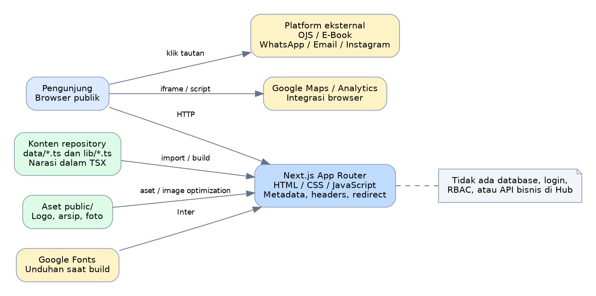
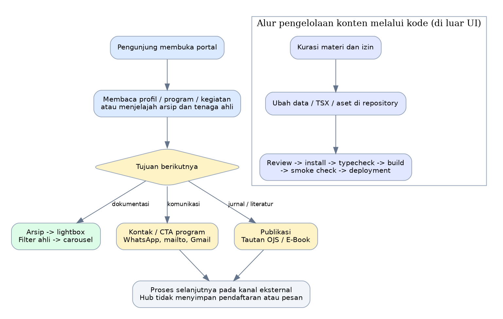
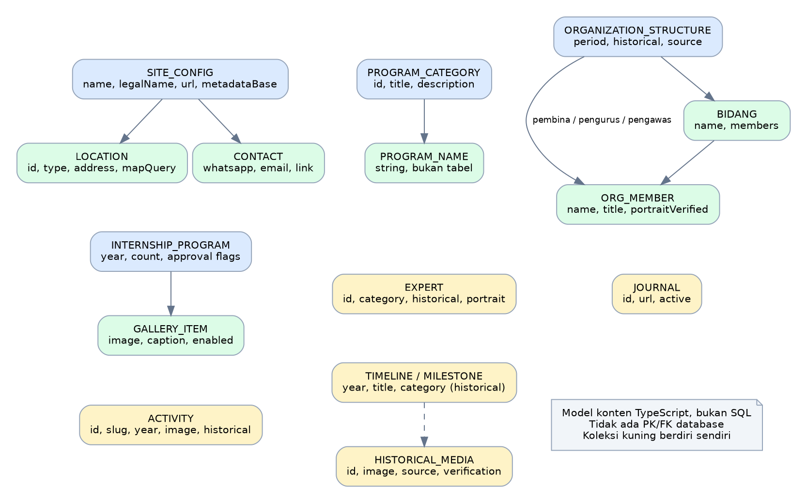
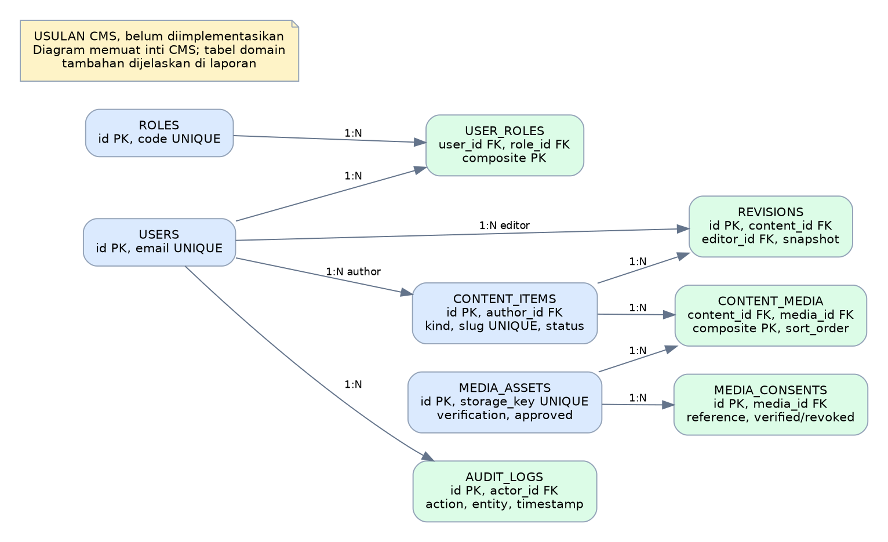

# 1. Ringkasan eksekutif

**P4I Corporate Hub adalah portal informasi kelembagaan Pusat Pendidikan dan Penelitian Pembangunan Indonesia (P4I).** Sistem menyajikan profil lembaga, program, kegiatan, arsip historis, jejaring tenaga ahli, informasi magang, kontak kantor, serta pintu masuk ke platform jurnal dan e-book. Arsitekturnya berupa aplikasi Next.js App Router dengan konten yang disimpan dalam berkas TypeScript dan aset lokal.

Dalam repositori yang diaudit **tidak ditemukan database, autentikasi, akun pengguna, role-based access control (RBAC), dashboard admin, CMS, API bisnis, pembayaran, atau penyimpanan pendaftaran**. Pengunjung menghubungi lembaga melalui WhatsApp, email, Gmail, dan Instagram. Proses korespondensi berlangsung di kanal tersebut. Submission artikel, review, dan editorial disebut dalam konten sebagai kemampuan platform OJS eksternal; proses itu tidak diimplementasikan oleh Corporate Hub.

Kesimpulan kesiapan teknis: instalasi dependensi dan build produksi berhasil; TypeScript lulus; seluruh 10 halaman publik yang diuji mengembalikan HTTP 200. Namun, keberhasilan build tidak berarti semua perilaku maupun keamanan telah terverifikasi. Ditemukan dua referensi gambar hero yang menghasilkan 404, aturan publikasi foto magang yang belum mengendalikan rendering, feature flag yang sebagian besar belum digunakan, dan advisory dependensi yang perlu ditangani.

Prioritas keputusan:

1. Tinjau dan perbaiki dependensi yang dilaporkan `npm audit`, terutama Next.js dan jalur pemrosesan gambar; jangan langsung menjalankan pembaruan major tanpa pengujian.
2. Perbaiki dua jalur aset hero dan terapkan aturan publikasi media yang eksplisit serta terdokumentasi.
3. Pertahankan bentuk portal sederhana jika kebutuhan utama tetap informasi publik. Tambahkan CMS, database, dan akun hanya jika kebutuhan pengelolaan konten atau layanan transaksi sudah disepakati.
4. Tambahkan pemeriksaan otomatis untuk route, aset, feature flag, metadata, aksesibilitas, dan build sebelum rilis.

# 2. Identitas audit, sumber, dan batas pemeriksaan

| Elemen | Hasil |
|---|---|
| Repositori | `HannR002/p4i-corporate-hub` |
| Branch referensi | `main` |
| Commit lokal dan remote main | `2e6ae709edaa1e21b4b71d15c7f8d43431296f57` |
| Pesan commit | `feat(v3.1): strengthen SEO, institutional trust and carousel polish` |
| Tanggal audit | 8 Oktober 2026, waktu pengguna Asia/Jakarta |
| Lingkungan pengujian | Checkout cloud di `/workspace/p4i-corporate-hub`; Node.js 24.19.0; npm 11.9.0 |
| Sumber utama | Kode aplikasi, konfigurasi, data, lockfile, instruksi agent, aset, respons HTTP lokal produksi, dan keluaran npm audit |
| Skala kode | 110 berkas tracked; 4.557 baris pada berkas TS, TSX, JS, CSS di app/components/data/lib/scripts |
| Perubahan aplikasi | Tidak ada perubahan source, dependency declarations, atau lockfile oleh audit ini |

Remote GitHub dibaca melalui operasi read-only `git ls-remote origin refs/heads/main`. SHA remote cocok dengan checkout; laporan merujuk versi tersebut. Audit mencakup pemeriksaan statis kode, instalasi yang telah dilakukan dalam sesi setup, build produksi baru, TypeScript, pemindaian dependency advisory, pemeriksaan referensi aset lokal, dan 18 permintaan HTTP produksi.

**Batas bukti:** audit ini tidak menguji website produksi publik, akses admin hosting, dashboard Google Analytics, DNS, sertifikat domain produksi, kebijakan CDN, isi database eksternal, backend OJS/e-book, atau operasi email/WhatsApp sesungguhnya. Tidak dilakukan pentest eksploitasi, browser E2E, Lighthouse, pengukuran Core Web Vitals, pengujian screen reader, maupun pengujian beban. Status HTTP 200 menunjukkan respons server berhasil, bukan bahwa seluruh tampilan dan interaksi browser telah diuji.

Istilah yang digunakan:

- **Terimplementasi:** ada kode yang menjalankan kemampuan tersebut.
- **Teruji:** ada pemeriksaan dalam audit ini dengan hasil yang dicatat.
- **Deklaratif/dorman:** ada konfigurasi atau model, tetapi belum menjadi kemampuan lengkap.
- **Eksternal:** disediakan melalui tautan/iframe/pihak ketiga, bukan backend dalam repositori.
- **Usulan:** rancangan pengembangan; bukan keadaan saat ini.

# 3. Tujuan bisnis dan batas sistem

## 3.1 Tujuan yang terlihat dari aplikasi

Portal membangun identitas lembaga, memperkenalkan area pendidikan dan penelitian, mendokumentasikan rekam jejak, menampilkan informasi historis secara bertanggung jawab, dan mengarahkan pengunjung ke kanal komunikasi maupun publikasi. Sasaran pengunjung meliputi masyarakat, akademisi, peneliti, calon mitra, calon peserta pelatihan, dan calon peserta magang.

## 3.2 Kemampuan yang berada di dalam Corporate Hub

- Penyajian halaman publik dan navigasi desktop/mobile.
- Rendering katalog program serta jurnal aktif dari data statis.
- Penyajian timeline dan arsip visual.
- Filter kategori tenaga ahli dan carousel.
- Pembukaan foto arsip melalui lightbox.
- Penyajian dua lokasi kantor beserta embed peta.
- Tautan komunikasi, metadata SEO, sitemap, robots, gambar Open Graph, dan redirect jurnal.

## 3.3 Kemampuan di luar Corporate Hub

| Layanan | Bentuk integrasi | Batas tanggung jawab |
|---|---|---|
| Jurnal P4I | Tautan ke `journal.p4ijournal.org` dan redirect `/journal/:path*` | Akun penulis/reviewer/editor, submission, review, dan database OJS berada di platform lain; belum diaudit |
| P4I E-Book | Tautan ke `publisher.p4ijournal.org` | Katalog, akun, unduhan, lisensi, dan kemungkinan transaksi pada platform tersebut belum diketahui |
| WhatsApp | Deep link `wa.me` dengan pesan awal | Hub mengawali komunikasi; tidak mengirim atau menyimpan pesan |
| Email/Gmail | `mailto:` dan URL compose Gmail | Pengiriman bergantung pada aplikasi/akun email pengunjung |
| Instagram | Tautan profil | Interaksi berlangsung di Instagram |
| Google Maps | Iframe dan tautan peta berdasarkan alamat | Peta serta kebijakan pihak ketiga berada di Google |
| Google Analytics | Komponen GoogleAnalytics di root layout | Konfigurasi pengumpulan/retensi di akun GA belum diperiksa |
| Google Fonts | `next/font/google` untuk Inter | Unduhan diperlukan saat kompilasi; font hasil build disajikan oleh aplikasi |

Istilah “ekosistem digital terintegrasi” pada halaman berarti keterhubungan navigasi yang terlihat dalam kode. Tidak ditemukan bukti sinkronisasi data, SSO, shared database, atau API antarplatform.

# 4. Arsitektur sistem



## 4.1 Komponen utama

1. **Browser pengunjung:** menerima HTML, CSS, JavaScript, dan gambar; menjalankan navigasi, state menu, filter ahli, carousel, serta lightbox.
2. **Next.js App Router:** menangani route berbasis folder, shared layout, kompilasi, prerender halaman, metadata, image optimization, header, dan redirect.
3. **Lapisan konten:** `data/*.ts` untuk daftar terstruktur serta `lib/site-config.ts` untuk identitas, alamat, kontak, dan branding. Konten naratif juga terdapat langsung dalam TSX halaman.
4. **Lapisan aset:** `public/brand` dan `public/archive/p4i` menyimpan aset yang dapat diakses publik. `_source` memuat dokumen serta gambar sumber untuk kurasi, bukan document store aplikasi.
5. **Layanan eksternal:** Google Fonts, Analytics, Maps, jurnal, e-book, dan kanal komunikasi.

## 4.2 Pola rendering dan state

Build mengidentifikasi halaman bisnis sebagai konten statis yang diprerender. `/opengraph-image` bersifat dinamis dan memakai runtime `edge`; build memberi peringatan bahwa runtime tersebut deprecated pada versi yang terpasang dan menonaktifkan static generation untuk route itu.

Halaman beranda dan rekam jejak merupakan Client Components (`'use client'`). Navbar, PageHero, ContactLauncher, ExpertCarousel, dan Lightbox juga menjalankan kode klien. Client Component tetap dapat memiliki HTML awal yang diprerender; istilah ini tidak berarti semuanya baru muncul setelah request API browser.

State berupa React `useState`, `useRef`, dan `useEffect`; tidak ditemukan state bisnis persisten, Redux, store global bisnis, atau penyimpanan database. Contoh state: `mobileOpen`, `scrolled`, `activeCategory`, `isPaused`, `filteredExperts`, `lightboxMedia`, dan `isOpen` panel kontak.

## 4.3 Jalur data

Data TypeScript diimpor → dipilih/filter oleh halaman atau komponen → dirender oleh React/Next.js → HTML/JS dikirim ke browser → interaksi mengubah state lokal. Tidak ada alur pengunjung menulis data kembali ke Corporate Hub.

## 4.4 Teknologi dan bahasa

| Teknologi | Versi lockfile | Peran |
|---|---|---|
| TypeScript | 7.0.2 | Model konten, konfigurasi, dan logika bertipe |
| TSX / React | React dan React DOM 19.2.8 | Komponen UI dan markup |
| Next.js | 16.3.0 | Framework full-stack; penggunaan saat ini dominan portal statis |
| JavaScript | — | Config Tailwind/PostCSS dan script logo |
| CSS / Tailwind CSS | Tailwind 3.4.19 | Styling responsif dan utilities |
| PostCSS / Autoprefixer | 8.5.26 / 10.5.4 | Pemrosesan CSS |
| Framer Motion | 13.0.0 | Animasi UI, terutama PageHero |
| Lucide React / React Icons | 1.30.0 / 5.7.0 | Ikon antarmuka |
| @next/third-parties | 16.3.0 | Integrasi Google Analytics |
| next-themes | 0.4.6 | Dependensi tema; provider belum dipakai root layout |
| Sharp | 0.35.3, transitif | Pemrosesan gambar Next.js; juga dipakai script logo |
| JSON | — | package.json, lockfile, tsconfig |
| Node.js / npm | Runtime audit 24.19.0 / 11.9.0 | Instalasi, build, dan server |

Bahasa konten utama adalah bahasa Indonesia; sebagian label program dan kepakaran menggunakan bahasa Inggris. Root HTML menggunakan `lang="id"`. Tidak ditemukan konfigurasi i18n untuk multi-bahasa. `target` TypeScript adalah ES2017; target output bukan versi Node.js. `strict:false` dan `skipLibCheck:true` menunjukkan pemeriksaan tipe belum memakai konfigurasi paling ketat.

PostCSS saat ini memakai plugin `tailwindcss` dan `autoprefixer`. Paket `@tailwindcss/postcss` versi 4.3.3 tercantum tetapi belum dipakai dalam config; ini bukan bukti bahwa aplikasi telah migrasi ke Tailwind v4.

# 5. Peta halaman dan fitur

| Route | Fitur/konten | Sumber data | Status audit |
|---|---|---|---|
| `/` | Profil singkat, bidang kegiatan, preview program/jurnal, ekosistem digital, timeline, preview kegiatan, CTA kolaborasi | siteConfig, programs, journals, timeline, activities | 200; prerender statis |
| `/tentang` | Sejarah, arah organisasi, bidang kegiatan, struktur historis 2014, jejaring ahli, timeline, Hutan Organik | organization, experts, timeline, siteConfig | 200 |
| `/program` | Empat kategori, 23 nama program, CTA WhatsApp | programCategories | 200; tidak ada booking atau pendaftaran online |
| `/publisher` | Kanal OJS dan e-book, preview ISTE | activeJournals, tautan eksternal | 200; bukan backend penerbitan |
| `/rekam-jejak` | Timeline, arsip Hutan Organik, lightbox, CTA magang dan publikasi | historyTimeline, historical-media | 200; gambar hero 404 |
| `/kegiatan` | Kegiatan terkini dan arsip historis; kartu dengan CTA opsional | activities | 200; gambar hero 404 |
| `/magang` | Institusi, tahun, jumlah peserta, fokus, privasi, galeri | internshipProgram | 200; bukan sistem administrasi magang |
| `/kontak` | Dua kantor, Maps, WhatsApp, email, Gmail, Instagram | siteConfig | 200; tidak ada form submit |
| `/kebijakan-privasi` | Penjelasan pengumpulan informasi dan pihak ketiga | TSX naratif | 200 |
| `/syarat-ketentuan` | Ketentuan informasi, historis, hak cipta, tautan eksternal | TSX naratif | 200 |
| `/layanan/konsultasi` | Route dorman; notFound ketika consulting=false | features.consulting | 404 yang sesuai konfigurasi |
| `/journal/:path*` | Redirect permanen ke domain jurnal dan path yang bersesuaian | next.config.mjs | `/journal/test` → 308 ke `https://journal.p4ijournal.org/journal/test` |
| `/sitemap.xml` | Daftar 10 URL publik | app/sitemap.ts | 200, 10 URL |
| `/robots.txt` | Allow semua crawler dan lokasi sitemap | app/robots.ts | 200 |
| `/opengraph-image` | PNG 1200×630 identitas P4I | ImageResponse, siteConfig | 200; signature PNG benar |

## 5.1 Rincian fitur interaktif

- **Navbar:** menandai route aktif, mengubah tampilan ketika scroll melewati 10 px, menyediakan toggle menu mobile, dan menutup menu saat link mobile diklik.
- **ExpertCarousel:** filter kategori, panah sebelumnya/berikutnya, scroll horizontal, autoplay 5,5 detik, kembali ke awal saat mencapai akhir, pause saat hover/focus, serta memeriksa prefers-reduced-motion untuk autoplay.
- **Lightbox arsip:** klik kartu membuka foto, caption dan sumber; close button, klik area backdrop, serta Escape menutup; body scrolling dinonaktifkan saat terbuka.
- **ContactLauncher:** panel bantuan mengambang untuk komunikasi; Escape menutup dan mengembalikan focus ke launcher; terdapat usaha membatasi focus Tab.
- **PageHero:** komponen judul reusable dengan background opsional, overlay, compact mode, CTA anak, dan animasi Framer Motion.
- **Gambar:** `next/image` digunakan pada banyak aset untuk sizing dan optimasi. Foto arsip dilengkapi alt dan sumber dalam data.

## 5.2 Fitur yang belum ada

Tidak ditemukan search global, detail kegiatan berdasarkan `[slug]`, pagination, editor konten, upload admin, login, reset password, pendaftaran kelas/magang, penjadwalan, pembayaran, notifikasi email dari server, status permohonan, CRM, laporan transaksi, atau WebGIS interaktif. Data `slug` pada kegiatan belum menjadi route detail. Jumlah peserta magang adalah ringkasan konten, bukan hasil query daftar peserta.

## 5.3 Feature flag: deklarasi versus implementasi

`lib/features.ts` mendeklarasikan flag aktif: publisher, journal, ebook, training, research, activities, history, internship. Flag nonaktif: legal, books, webgis, consulting, digitalServices, partners, mou, publicStatistics.

Pencarian pemakaian menunjukkan hanya `features.consulting` dipakai oleh aplikasi untuk mengendalikan route. Navigasi dan sitemap memakai array tetap. Karena itu, mengubah `features.internship`, `features.history`, atau flag lain belum otomatis menyembunyikan halaman, link, maupun sitemap. Komentar “centralized toggle” belum didukung seluruh kode. `siteConfig.legal.enabled` juga merupakan deklarasi data terpisah; tidak ditemukan panel legalitas yang menggunakannya.

Route konsultasi mengembalikan `null` jika flag diaktifkan. Mengubah flag menjadi true saja menghasilkan halaman tanpa konten layanan, bukan fitur konsultasi lengkap.

# 6. Peran pengguna, jabatan organisasi, dan matriks akses

## 6.1 Peran sistem yang benar-benar ada

**Pengunjung publik** adalah satu-satunya kelas akses aplikasi yang tampak pada runtime. Setiap pengunjung dapat mengakses halaman publik yang sama. Tidak ada pemeriksaan akun atau permission per pengguna.

**Pengelola konten/developer** adalah aktor operasional di luar antarmuka aplikasi: mengubah data dan aset melalui repository, lalu melakukan build/deployment. Akses GitHub atau hosting tidak sama dengan role yang diimplementasikan Corporate Hub. Cabang, reviewer, dan aturan approval repository tidak dapat disimpulkan dari checkout.

**Petugas kontak lembaga** adalah aktor bisnis di kanal komunikasi eksternal. Ia menerima dan menindaklanjuti pertanyaan melalui kanal resmi; Corporate Hub tidak mempunyai inbox atau dashboard untuk aktor tersebut.

## 6.2 Segmentasi pengunjung dan use case

Semua segmen berikut memiliki hak akses publik yang sama; segmentasi menjelaskan tujuan pengguna, bukan RBAC.

| Aktor/segmen | Use case utama | Hasil akhir di Hub | Batas |
|---|---|---|---|
| Masyarakat/pengunjung umum | Membaca profil, sejarah, kegiatan, kebijakan, lokasi | Informasi tampil | Tidak memerlukan akun |
| Akademisi/peneliti/penulis | Mengenali ISTE, membuka portal jurnal, mencari kontak kolaborasi | Beralih ke jurnal atau komunikasi | Submission dan akun ada di luar Hub |
| Calon mitra/institusi | Memeriksa bidang kepakaran, rekam jejak, ahli, kantor; menghubungi P4I | Kanal kontak dibuka | Tidak ada proposal tracker/MoU di Hub |
| Calon peserta pelatihan | Menjelajah kategori dan nama program; mendiskusikan kebutuhan melalui WhatsApp | WhatsApp dibuka dengan pesan awal | Tidak ada jadwal, harga, kuota, atau enrollment |
| Calon peserta magang/sekolah | Membaca ringkasan magang dan dokumentasi; meminta informasi melalui kontak | Informasi/kontak tersedia | Tidak ada formulir seleksi atau status peserta |
| Pembaca literatur | Membuka platform e-book | Beralih ke domain publisher | Unduhan/katalog eksternal belum diaudit |
| Pengelola konten/developer | Mengubah konten terkurasi, aset, konfigurasi; build dan rilis | Versi situs diperbarui setelah deployment | Dilakukan melalui tools repository/hosting |
| Petugas kontak | Menerima komunikasi dan melakukan tindak lanjut manual | Tindak lanjut di kanal eksternal | Tidak dicatat otomatis oleh Hub |

## 6.3 Jabatan kelembagaan yang ditampilkan

Sumber `data/organization.ts` secara eksplisit merupakan **struktur historis tahun 2014**, bukan verifikasi pengurus aktif 2026. Jabatan yang dicantumkan: Pembina; Pengawas; Pengurus yang terdiri dari Ketua, Sekretaris, Bendahara; serta bidang Administrasi dan Keuangan, Pendidikan dan Penelitian Pembangunan, Kerjasama/Sosial/Keagamaan/Kemanusiaan, dan Pendidikan Umum/Bimbel.

Jabatan tersebut ditampilkan sebagai konten. Tidak ada permission “Pembina”, “Ketua”, “Bendahara”, maupun “Tenaga Ahli” dalam kode akses aplikasi. Model `currentOrganization` masih `enabled:false` dan belum berisi anggota.

## 6.4 Peran pada platform eksternal

Konten menyebut penulis/reviewer dan proses editorial pada OJS. Peran penulis, reviewer, editor, pengelola jurnal, serta administrator dapat menjadi lingkup audit OJS tersendiri, tetapi daftar role, kewenangan, autentikasi, dan use case aktualnya **belum dapat dipastikan** dari repositori Corporate Hub. Untuk memastikan dibutuhkan repository/config OJS atau akses inspeksi yang sesuai. Jangan menggunakan dokumen ini sebagai bukti implementasi role OJS.

## 6.5 Spesifikasi use case implementasi saat ini

| ID / use case | Aktor dan prasyarat | Alur dan hasil | Alternatif/batas |
|---|---|---|---|
| UC01 Membaca informasi kelembagaan | Pengunjung; URL portal dapat diakses | Buka beranda/tentang → baca profil dan struktur historis → informasi tampil tanpa login | URL tidak tersedia menghasilkan 404; struktur aktif 2026 belum diverifikasi |
| UC02 Menjelajah program | Calon peserta/institusi; halaman program tersedia | Buka program → baca kategori dan nama program → pilih CTA diskusi | Tidak ada pemilihan jadwal, kuota atau pendaftaran tersimpan |
| UC03 Menghubungi P4I | Semua pengunjung; kanal kontak tersedia | Buka kontak/panel → pilih WhatsApp/email/Gmail → aplikasi eksternal compose terbuka | Jika aplikasi/akun eksternal tidak tersedia, pengunjung perlu kanal alternatif; Hub tidak mendapat delivery status |
| UC04 Menjelajah ahli | Calon mitra/peneliti; JavaScript aktif untuk filter | Buka tentang → pilih kategori → kartu difilter → navigasi carousel | Autoplay berhenti saat hover/focus dan ketika reduced-motion aktif; hasil bergantung pada data terkurasi |
| UC05 Membaca dan memperbesar arsip | Pengunjung; foto dan JavaScript tersedia | Buka rekam-jejak → pilih media → lightbox → baca caption/sumber → tutup | Jalur foto gagal menyebabkan media tidak termuat; behavior browser belum diuji E2E |
| UC06 Menuju jurnal atau e-book | Pembaca/penulis; platform eksternal dapat diakses | Buka publisher/kartu jurnal → klik tautan → browser berpindah ke platform eksternal | Gangguan/izin platform eksternal di luar Hub; login/submission bukan postcondition Hub |
| UC07 Membaca informasi magang | Calon peserta/sekolah; halaman publik tersedia | Buka magang → lihat ringkasan program dan dokumentasi → gunakan kontak jika perlu | Tidak ada pencatatan peserta/seleksi; publikasi foto membutuhkan governance sebagaimana temuan audit |
| UC08 Memperbarui konten | Developer/pengelola; akses repository dan deploy sesuai otorisasi | Kurasi → edit data/TSX/aset → review → build/check → deploy → konten baru tampil | Build/deploy gagal: perbaiki atau rollback; aplikasi tidak mempunyai editor/admin UI |
| UC09 Menindaklanjuti pertanyaan | Petugas kontak; pertanyaan sudah dikirim oleh pengunjung | Buka kanal resmi → klarifikasi kebutuhan → tindak lanjut manual | Use case operasional eksternal; tidak ada log/inbox/status otomatis di Hub |

Postcondition use case publik umumnya adalah informasi ditampilkan atau kanal eksternal dibuka. Tidak ada postcondition berupa akun baru, pembayaran sukses, record enrollment, atau artikel diterbitkan di dalam Corporate Hub.

# 7. Workflow sistem



## 7.1 Workflow akses dan navigasi

1. Pengunjung meminta URL.
2. Next.js menyelesaikan route atau redirect.
3. Root layout menyertakan identitas HTML, Navbar, Footer, ContactLauncher, JSON-LD, dan GoogleAnalytics.
4. Halaman mengambil konten dari import data/config dan menghasilkan tampilan.
5. Browser menjalankan interaksi setelah JavaScript aktif.
6. Pengunjung membaca konten, membuka halaman lain, atau mengikuti tautan eksternal.

Exception: URL yang tidak ditemukan mendapat 404; `/layanan/konsultasi` juga 404 sesuai flag. Ketersediaan halaman tidak bergantung pada database atau layanan login.

## 7.2 Workflow informasi program dan komunikasi

Pengunjung membuka `/program` → memilih/membaca kategori → menekan CTA “Diskusikan Kebutuhan Pelatihan” → browser membuka WhatsApp dengan pesan awal → pengunjung memilih mengirim pesan → petugas menindaklanjuti di WhatsApp. **Klik CTA tidak berarti pesan telah terkirim atau pendaftaran berhasil.** Tidak ada record pendaftaran atau konfirmasi otomatis dari Hub.

Email serupa: memilih aplikasi email/Gmail → compose terbuka dengan tujuan/subjek/pesan awal → pengunjung mengirim melalui aplikasi tersebut. Hub tidak menyediakan SMTP/API pengiriman dan tidak menerima delivery status.

## 7.3 Workflow publikasi

Pengunjung membuka `/publisher` atau kartu jurnal → melihat jurnal dengan `active:true` → mengikuti URL jurnal/e-book → berpindah ke platform eksternal. Legacy URL `/journal/...` mendapat redirect permanen. Tahap pembuatan akun, unggah naskah, review, keputusan editorial, dan publikasi selanjutnya berada di sistem eksternal dan belum diverifikasi.

## 7.4 Workflow arsip

Pengunjung membuka `/rekam-jejak` → membaca timeline → memilih arsip → `lightboxMedia` diisi object media → Lightbox menampilkan foto, caption, sumber dan label visual-only jika sesuai → Escape/close/backdrop mengosongkan state. Tidak ada perubahan data server atau download log bisnis.

Timeline mengaitkan item transformasi digital 2014/2026 dengan media menggunakan kategori dan tahun serta pencarian ID spesifik; bukan foreign key relasional. Menambah timeline tidak otomatis menghasilkan asosiasi media jika pola itu tidak ditambahkan.

## 7.5 Workflow jejaring ahli

Pengunjung membuka `/tentang` → carousel menerima daftar experts → kategori dipilih → daftar difilter → scroll kembali ke awal → pengguna menavigasi kartu atau membiarkan autoplay. Pause berlaku ketika hover/focus. Data keahlian dan foto merupakan konten, bukan akun ahli.

## 7.6 Workflow konten dan rilis

Keadaan sekarang: pengelola menyiapkan materi → developer mengubah `data`, `lib`, TSX atau aset → perubahan ditinjau melalui praktik repository yang berlaku → `npm ci` → TypeScript/build → server dijalankan → smoke check → deployment melalui mekanisme hosting. Langkah peninjauan/persetujuan adalah proses operasional yang disarankan; tidak ditemukan otomatisasi approval atau deployment di checkout.

Perubahan konten membutuhkan rebuild/redeploy untuk produksi. Tidak ada publish button CMS atau revalidation berbasis event dalam kode.

# 8. Database, ERD, dan kamus data

## 8.1 Keadaan database saat ini

**Corporate Hub tidak memakai database dalam implementasi yang ditemukan.** Tidak ada Prisma, Drizzle, Sequelize, Mongoose, Supabase client, SQL schema, migration, connection string, atau driver database. Persistence konten berasal dari Git/filesystem dan hasil build. React state bersifat sementara di browser.

Database platform jurnal/e-book tidak berada dalam audit ini. Tidak boleh menyimpulkan “MySQL”, “PostgreSQL”, atau tabel OJS aktual hanya dari link platform.

## 8.2 ERD konseptual konten saat ini

Diagram berikut memenuhi kebutuhan pemetaan entitas/relasi konten, **bukan ERD database yang sudah dibuat**. Relasi menggambarkan nesting objek dan asosiasi semantik yang terlihat. Field ID adalah identifier aplikasi; bukan constraint primary key SQL. Tidak ada foreign key atau integritas referensial database.



- SITE_CONFIG memiliki banyak LOCATION dan satu CONTACT; SOCIAL dan LEGAL berupa objek konfigurasi.
- PROGRAM_CATEGORY memiliki banyak nama program yang disimpan sebagai `string[]`, bukan tabel PROGRAM.
- ORGANIZATION_STRUCTURE memuat anggota pembina/pengawas/pengurus dan bidang; anggota dapat diulang pada beberapa bagian tanpa ID person bersama.
- INTERNSHIP_PROGRAM memuat banyak item galeri dengan flag `enabled`.
- EXPERT, JOURNAL, ACTIVITY, HISTORICAL_MILESTONE, dan HISTORICAL_MEDIA adalah koleksi konten independen. `category` banyak berupa string/union, bukan referensi tabel kategori.
- Media activity, expert, dan galeri menggunakan path string ke public asset. Path tersebut tidak diperiksa constraint database.

## 8.3 Kamus data implementasi

| Model/sumber | Field penting | Jumlah/keadaan | Catatan relasi/validasi |
|---|---|---|---|
| SiteConfig | name, fullName, legalName, tagline, established, url, metadataBase | 1 objek | Nilai institusi terpusat, beberapa konten masih diulang di TSX |
| Location | id, type, label, city, address, mapQuery | 2 kantor: Bogor dan Jambi | Nested dalam siteConfig |
| Contact | whatsappDisplay, whatsappLink, whatsappNumber, email, emailLink | 1 objek | Link komunikasi; bukan record pesan |
| Legal configuration | enabled, nomor/tanggal akta, notary, decree, domicile, document URL | Disabled, field dokumen kosong | Kekosongan bukan bukti legalitas lembaga tidak ada; hanya belum dipublikasikan oleh konfigurasi |
| ProgramCategory | id, title, description, icon, programs | 4 kategori, 23 string program | 8 GIS; 6 regional; 7 lingkungan; 2 institutional |
| Journal | id, name, shortName, scope, description, url, active, color; metadata opsional ISSN/indexing/accreditation/doi | 1 jurnal aktif ISTE | `activeJournals` filter `active`; field ISSN kosong tidak ditampilkan |
| Activity | id, slug, title, description, date?, year, category, historical, image?, alt?, gallery?, location?, source?, ctaText?, ctaLink? | 9: 1 nonhistoris, 8 historis | `slug` belum dipakai route; `gallery` belum menjadi fitur detail |
| Expert | id, name, expertise, qualification, category, historical, sourceLabel, portrait?, skills? | 21: 20 historis, 1 tambahan digital nonhistoris | Kategori union; semua muncul pada filter Semua |
| OrganizationStructure | period, historical, source, pembina, pengurus, pengawas, bidang | Periode 2014 | 1 pembina, 3 pengurus, 2 pengawas, 4 bidang |
| OrgMember | name, title?, portrait?, portraitExpectedFilename?, portraitVerified? | Nested; sebagian orang berulang | Foto hanya dipakai ketika portraitVerified dan portrait tersedia |
| Milestone | year, title, description | 5 item di timeline.ts | Dipakai beranda/tentang |
| HistoricalMilestone | year, title, description, category, date?, themes? | 6 item di history.ts | Dipakai rekam-jejak; model berbeda dari Milestone |
| HistoricalMedia aktif | id, title, period?, year?, category, image, alt, caption, source, sourceUrl?, historical, verification | 11 item di historical-media.ts | 4 verified, 7 visual-only; status adalah label internal yang belum diverifikasi audit |
| InternshipProgram | institution, year, participantCount, current, publicationConsentVerified, publicationApprovedForWebsite, gallery | SMK Adhiyaksa Bogor, 2026, 4 peserta; 7 foto data | Halaman menampilkan 5 foto pertama: 1 featured + 4 supporting |
| InternshipGalleryItem | image, alt, caption, source, enabled | 7 item enabled=true | Flag enabled belum dipakai filter rendering |
| NavItem | label, href, external? | Menu utama 7 item; footer mempunyai daftar sendiri | Array menu tetap |
| DigitalPlatform | id, title, shortTitle, description, url, status, external | 3 platform dalam data/platforms.ts | Model tidak diimpor halaman aktif; sebagian UI memakai URL hardcoded |

Ada pula `HistoricalMedia` dan `historyGallery` lama pada `data/history.ts`, berbeda dari versi aktif pada `data/historical-media.ts`. Komponen galeri lama mempunyai data placeholder sendiri. Ini perlu dibedakan untuk mencegah pengelola mengedit sumber yang tidak dipakai UI.

## 8.4 Jika nanti dibutuhkan CMS/database: ERD usulan

**Rancangan berikut belum diimplementasikan.** Kebutuhan paling masuk akal adalah pengelolaan konten, bukan langsung sistem transaksi penuh. Kandidat database relasional adalah PostgreSQL; pemilihan akhir harus mempertimbangkan hosting, kompetensi pengelola, backup, dan integrasi CMS. Tidak perlu memindahkan database OJS ke Corporate Hub.



| Tabel usulan | Kolom/constraint penting | Tujuan |
|---|---|---|
| users | id PK, email UNIQUE, display_name, auth_subject UNIQUE, active | Identitas pengelola; autentikasi dengan provider yang disepakati |
| roles / user_roles | roles.id PK, code UNIQUE; user_roles PK(user_id,role_id), FK | RBAC CMS, bukan jabatan organisasi |
| content_items | id PK, kind, slug UNIQUE, title, body, status, author_id FK users, published_at, updated_at | Konten halaman/kegiatan; status draft/review/published/archived |
| revisions | id PK, content_id FK, editor_id FK, snapshot, created_at | Riwayat perubahan |
| media_assets | id PK, storage_key UNIQUE, mime_type, alt, caption, source, verification_status, publication_approved | Metadata berkas; binary di storage terpisah |
| content_media | content_id FK, media_id FK, sort_order; composite key | Penggunaan satu media pada beberapa konten |
| media_consents | id PK, media_id FK, reference, verified_at, valid_until?, revoked_at? | Referensi bukti izin; dokumen izin tidak dipublikasikan |
| program_categories / programs | category.id PK; programs.id PK, category_id FK, title, active | Mengganti string[] bila butuh pengelolaan program individual |
| experts / expert_categories | experts.id PK, category_id FK, profile/source/historical | Model ahli konsisten |
| organization_periods / persons / memberships | FK period/person, position, division | Menghindari duplikasi orang dan membedakan periode historis/aktif |
| journals / locations | Identifier unik, metadata dan status aktif | CRUD konfigurasi bila diperlukan |
| audit_logs | id PK, actor_id FK, action, entity_type/id, timestamp | Jejak aksi admin/editor |

Jika registration diperlukan nanti, tambahkan tabel enrollment/inquiry hanya setelah mendefinisikan tujuan pengumpulan, akses, retensi, status proses, notifikasi, dan keamanan. Jangan membuat tabel peserta hanya untuk menampilkan foto/ringkasan program.

Peran CMS usulan: administrator mengelola akses/config; editor mengelola draft dan aset; reviewer konten memeriksa sumber/izin; publisher merilis konten. Pisahkan peninjauan dari penerbitan bila tim memerlukan kontrol tersebut. RBAC ini adalah usulan dan tidak boleh ditampilkan sebagai fitur yang sudah berjalan.

# 9. Struktur folder dan tanggung jawab kode

```text
p4i-corporate-hub/
├── app/
│   ├── layout.tsx                 # layout global, metadata, JSON-LD, analytics
│   ├── page.tsx                   # beranda
│   ├── globals.css                # Tailwind directives dan styles global
│   ├── opengraph-image.tsx         # generator gambar sosial
│   ├── sitemap.ts / robots.ts     # metadata routes crawler
│   ├── icon.png
│   ├── tentang/page.tsx
│   ├── program/page.tsx
│   ├── publisher/page.tsx
│   ├── rekam-jejak/page.tsx
│   ├── kegiatan/page.tsx
│   ├── magang/page.tsx
│   ├── kontak/page.tsx
│   ├── kebijakan-privasi/page.tsx
│   ├── syarat-ketentuan/page.tsx
│   ├── layanan/konsultasi/page.tsx
│   └── components/
│       ├── layout/                # Navbar, Footer, PageHero
│       ├── contact/               # ContactLauncher
│       ├── experts/               # ExpertCarousel, ExpertNetwork lama
│       ├── organization/          # OrganizationChart
│       ├── gallery/               # HistoricalGallery lama
│       └── ui/                    # Lightbox
├── components/ThemeProvider.tsx   # provider yang belum dipakai layout
├── data/                          # 11 modul konten TypeScript
├── lib/
│   ├── site-config.ts             # identitas, kantor, kontak, legal, GA
│   └── features.ts                # flag; penerapan masih parsial
├── public/
│   ├── brand/                     # logo transparan
│   ├── archive/p4i/
│   │   ├── hutan-organik/          # arsip lingkungan
│   │   ├── digital-history/        # screenshot sejarah digital
│   │   ├── maps/                   # peta historis
│   │   ├── people/                 # foto ahli
│   │   └── magang/                 # dokumentasi magang
│   └── p4i-logo.png
├── _source/                       # dokumen DOCX, extraction XML, foto sumber
├── scripts/process-logo.js        # pemrosesan transparansi logo
├── next.config.mjs                # security headers dan redirect
├── tsconfig.json                  # TypeScript, @/* → root
├── tailwind.config.js
├── postcss.config.js
├── package.json / package-lock.json
├── next-env.d.ts                  # generated; ternyata masih tracked
├── AGENTS.md / CLAUDE.md           # instruksi pengembangan
└── .gitignore
```

`node_modules`, `.next`, dan tsbuildinfo adalah artefak lokal pengembangan/build, bukan source bisnis. Pada audit, aset public sekitar 10,62 MB dan materi `_source` sekitar 27,62 MB. Ukuran ini adalah total filesystem, **bukan** ukuran unduhan sebuah halaman.

Tidak ditemukan folder API route bisnis, middleware autentikasi, skema database, migration, README setup, Dockerfile, ataupun workflow `.github` dalam checkout. Ini tidak membuktikan hosting tidak memiliki pipeline di luar repository.

# 10. Integrasi, keamanan, privasi, dan SEO

## 10.1 Keamanan yang sudah terlihat

Respons beranda memuat Content-Security-Policy, X-Frame-Options DENY, X-Content-Type-Options nosniff, dan Referrer-Policy strict-origin-when-cross-origin. Banyak tautan eksternal memakai `noopener noreferrer`. Data rendering berasal dari konten repository; tidak ditemukan input HTML bebas dari pengunjung. JSON-LD memakai `JSON.stringify` pada data internal.

Tidak adanya form/login mengurangi jenis serangan transaksi yang relevan. Namun Next.js, image optimization, generator Open Graph, JavaScript browser, dependency chain, dan layanan hosting tetap perlu diamankan.

CSP saat ini mengizinkan `unsafe-inline` dan `unsafe-eval` untuk script. Kebijakan ini ada, tetapi masih permisif. Usulan nonce/hash dan pengurangan eval harus diuji terhadap produksi Next.js serta analytics; jangan menerapkan perubahan CSP secara buta. Tidak ditemukan explicit HSTS/Permissions-Policy di config aplikasi; apakah sudah ditambahkan edge/hosting belum diketahui.

## 10.2 Privasi dan governance konten

Halaman magang menyatakan tidak menampilkan nama lengkap, kontak pribadi, atau nomor induk siswa. Namun data berisi `publicationConsentVerified:false`, `publicationApprovedForWebsite:true`; halaman tetap menampilkan foto tanpa memeriksa kedua status maupun `gallery.enabled`. Halaman kegiatan juga menampilkan gambar magang dari data terpisah. Ini membuktikan **aturan teknis publikasi belum ditegakkan**, bukan membuktikan tidak pernah ada izin. Bukti izin harus diperiksa oleh pengelola yang berwenang.

GoogleAnalytics dipasang di layout tanpa consent gate yang terlihat. Pernyataan “secara anonim” pada kebijakan perlu diselaraskan dengan konfigurasi aktual GA, identifier/cookie, tujuan penggunaan, retensi, serta aturan yang berlaku. Audit tidak menyimpulkan kepatuhan hukum karena config akun dan yurisdiksi pemrosesan belum diperiksa.

Dokumen sumber `_source` tidak otomatis menjadi URL publik Next.js karena berada di luar `public`; jangan menyebutnya kebocoran HTTP tanpa bukti. Namun jika berisi informasi internal/personal, akses repository dan paket deployment perlu ditinjau. `.gitignore` memiliki byte NUL pada baris `_source`, dan folder tersebut sudah tracked; ignore rule tidak mengeluarkan file yang telah tracked.

## 10.3 SEO

Sudah tersedia metadata global, title template, description, keywords, robots, Open Graph, JSON-LD WebSite/Organization, sitemap 10 URL, gambar sosial, dan canonical pada beberapa halaman. `GOOGLE_SITE_VERIFICATION` opsional belum diisi; ini tidak memblokir rendering.

Gap: beranda dan rekam-jejak tidak mendefinisikan metadata halaman tersendiri; canonical belum ada pada beranda, rekam-jejak, kontak, privasi, syarat. Sitemap menggunakan `new Date()` untuk seluruh lastModified dan frekuensi weekly seragam; tidak mewakili tanggal perubahan tiap konten. Metadata/jalur harus tetap konsisten jika domain produksi berubah.

# 11. Hasil validasi yang benar-benar dijalankan

| Pemeriksaan | Hasil | Interpretasi |
|---|---|---|
| Git read remote main | Lulus; SHA sama | Analisis sesuai tip main saat audit |
| Instalasi `npm ci` | Lulus pada setup sesi ini, 134 paket ditambahkan | Dependensi diinstal tanpa mengubah manifest/lockfile |
| `npm run build` | Exit 0; kompilasi dan TypeScript lulus; 16 keluaran static generation | Build produksi dapat dibuat; 16 bukan jumlah pengujian |
| `tsc --noEmit` | Exit 0 setelah build | Pemeriksaan tipe sesuai konfigurasi saat ini |
| Server `npm run start` | Berjalan; readiness 121 ms pada log | Kesiapan awal; waktu ini bukan benchmark umum |
| 10 halaman publik | Semua HTTP 200 | Respons server berhasil; tidak menguji browser interaktif |
| Route konsultasi | 404 | Expected sesuai flag false |
| Redirect jurnal | 308; Location sesuai | Perpindahan legacy URL bekerja |
| Sitemap/robots/logo | 200; sitemap 10 URL | Aset dan metadata dasar tersedia |
| Open Graph | 200; signature PNG benar | Generator gambar sosial dapat dieksekusi |
| Dua path hero yang salah | Keduanya 404 | Defect aset terkonfirmasi |
| Security headers beranda | Hadir | Konfigurasi header terobservasi lokal |
| `npm audit --json` | 11 package findings: 1 critical, 8 high, 2 moderate | Advisory dependency; bukan 11 eksploitasi yang dibuktikan |
| Git setelah audit | Bersih | Perubahan generated next-env oleh build dikembalikan; source tetap |

Pada setup sebelumnya Google Fonts sempat ditolak HTTP 403 dan development memakai fallback. Pada audit ini permintaan Google Fonts telah berhasil HTTP 200 dan build produksi normal lulus. Blocker jaringan tersebut **tidak lagi terobservasi pada instance audit ini**; ini tidak membuktikan publikasi konfigurasi atau restorasi di task baru.

Tidak ada script `test`, `lint`, maupun suite test dalam repositori yang ditemukan. Tidak ada klaim “semua unit test lulus”. Detail 18 permintaan HTTP tersedia pada `http-checks.json`; advisory mentah tersedia pada `npm-audit.json`.

# 12. Daftar temuan audit dan tindakan

Skala prioritas: **P1** ditinjau sebelum rilis berikutnya; **P2** diperbaiki dalam iterasi penguatan; **P3** perbaikan pemeliharaan. Severity dari npm dibedakan dari prioritas audit dan dari bukti eksploitabilitas.

## A01 — Advisory dependensi Next.js dan Sharp (P1)

**Bukti:** lockfile Next.js 16.3.0, Sharp 0.35.3; npm audit melaporkan Next.js critical dan Sharp high. Next.js mempunyai advisory pemrosesan gambar, ImageResponse, cache, dan dev server; Sharp mempunyai advisory library gambar transitif. Repository menggunakan next/image dan next/og, sehingga jalur terkait harus ditinjau. Advisory Windows belum tentu berlaku untuk instance Linux ini; reachability dan config deployment setiap advisory belum diuji.

**Dampak:** potensi risiko keamanan/availability sesuai prasyarat advisory. **Tindakan:** gunakan versi patch yang memperbaiki semua rentang advisory terlapor, tinjau release notes resmi, perbarui lockfile pada tugas coding terpisah, lalu ulang build, smoke routes, OG dan image optimizer. Keluaran audit menunjukkan beberapa rentang Next.js masih terdampak sampai `<16.3.8`; versi perbaikan harus dikonfirmasi saat patch, bukan memilih patch awal saja.

Contoh advisory yang dikembalikan registry: [ImageResponse GHSA-vcvr-r3jv-pc5j](https://github.com/advisories/GHSA-vcvr-r3jv-pc5j), [Image Optimization GHSA-2xp9-vwfh-vxw4](https://github.com/advisories/GHSA-2xp9-vwfh-vxw4), [SSRF GHSA-cjq9-62q9-8jv4](https://github.com/advisories/GHSA-cjq9-62q9-8jv4), [Sharp GHSA-rgj7-g3m4-5g8c](https://github.com/advisories/GHSA-rgj7-g3m4-5g8c). Tautan merupakan referensi output registry, bukan bukti audit telah mereproduksi eksploitasi.

## A02 — Dependency advisory pada toolchain CSS (P1/P2)

Paket lain yang terlapor: braces, chokidar, fast-glob, micromatch, nanoid, postcss-nested, postcss-selector-parser, source-map-js, dan tailwindcss. Beberapa adalah propagation melalui dependency tree; jangan menghitungnya sebagai vulnerability unik yang seluruhnya independen. Advisory di build-time mempunyai jalur risiko berbeda dari server publik.

`npm audit` menyarankan Tailwind 4.3.3 sebagai major upgrade pada beberapa jalur. Migrasi v3→v4 memerlukan penyesuaian config/plugin/CSS dan validasi tampilan. Jangan menjalankan `npm audit fix --force` sebagai perbaikan rutin tanpa review. Matriks lengkap ada di Lampiran B.

## A03 — Dua gambar hero memakai path yang tidak ada (P1)

- `app/kegiatan/page.tsx:29`: `/archive/p4i/hutan-organik-progress-rehabilitasi-2001-2014.webp`; aset tersedia di `/archive/p4i/hutan-organik/hutan-organik-progress-rehabilitasi-2001-2014.webp`.
- `app/rekam-jejak/page.tsx:23`: `/archive/p4i/p4i-website-profil-historis.png`; aset tersedia di `/archive/p4i/digital-history/p4i-website-profil-historis.png`.

Kedua path salah mengembalikan 404 pada server produksi. Perbaiki referensi dan tambahkan pemeriksaan path asset. Build tidak menangkapnya karena string URL runtime.

## A04 — Flag persetujuan dan enabled media magang tidak mengendalikan rendering (P1)

`data/internship.ts:7` menyatakan consent belum verified; `app/magang/page.tsx:17–18` memilih gallery[0] dan slice(1,5) langsung. Foto juga dirujuk `data/activities.ts`. Dokumentasikan kebijakan publikasi yang benar, verifikasi bukti izin, lalu terapkan kontrol konsisten pada seluruh pemakaian media; jangan hanya menyembunyikan satu galeri. Pemilik tindak lanjut: pengelola konten/penanggung jawab dokumentasi bersama developer.

## A05 — Feature flag belum menjadi mekanisme terpusat (P2)

Satu pemakaian flag nyata ada di konsultasi; navigasi/sitemap/halaman lain belum mengikuti flag. Dampak: pengelola dapat menyangka fitur telah disembunyikan padahal URL tetap tersedia. Usulan: registry route/fitur bersama yang mengontrol navigation, sitemap, dan notFound; tambahkan uji deaktivasi. Kontrol ini bukan pengganti authorization bila nanti ada data privat.

## A06 — Halaman konsultasi tetap kosong ketika diaktifkan (P2)

`app/layanan/konsultasi/page.tsx` berakhir dengan return null. Lengkapi konten/alur terlebih dahulu sebelum mengubah consulting menjadi true. Keadaan false sekarang bekerja sesuai harapan.

## A07 — Judul jejaring 2014 memuat tambahan nonhistoris (P2)

`app/tentang/page.tsx:172` memakai judul “Jejaring Tenaga Ahli (2014)”; carousel menerima semua experts, termasuk satu profil `historical:false` berlabel “P4I Digital”. Label sumber/historical belum ditampilkan per kartu carousel. Pisahkan arsip dan jejaring digital tambahan atau ubah judul/disclaimer serta tampilkan sumber/status per kartu. Audit tidak memverifikasi kredensial profesional setiap orang.

## A08 — Accessibility dialog belum lengkap (P2)

Lightbox punya role dialog, aria-modal, Escape, dan close button, tetapi tidak mengelola initial focus, focus trap, atau return focus ke pemicu. Panel kontak memiliki `aria-controls="contact-panel"` pada launcher tanpa ID tersebut pada panel. Fokus awal panel juga bukan otomatis elemen fokus pertama yang dipakai logika trap. Perbaiki menggunakan pola dialog teruji dan uji keyboard/screen reader. Ini temuan kode; tidak ada klaim hasil audit WCAG menyeluruh.

## A09 — Metadata route dan lastModified belum konsisten (P2)

Beranda/rekam-jejak menggunakan metadata global; beberapa halaman tanpa canonical khusus. Sitemap tidak memakai tanggal perubahan konten nyata. Tambahkan metadata route akurat dan kebijakan lastModified. Client page dapat dipisahkan dari server wrapper untuk metadata tanpa menghilangkan interaksi.

## A10 — Analytics dan kebijakan privasi perlu disejajarkan (P2)

GA di root layout tidak memiliki consent gate terlihat. Verifikasi setting akun, cookie/identifier, retensi, data sharing dan tujuan; sesuaikan isi kebijakan dan mekanisme consent bila diperlukan. Jangan mengklaim analytics sudah anonim dari teks halaman saja.

## A11 — CSP masih permisif; perlindungan edge belum diketahui (P2)

`unsafe-eval`/`unsafe-inline` membuat mitigasi script lebih lemah dibanding CSP nonce/hash yang tepat. Tinjau config production dan kebutuhan pihak ketiga, lalu lakukan perubahan bertahap dengan uji browser. HSTS/Permissions-Policy/TLS produksi membutuhkan audit hosting terpisah.

## A12 — Tidak ada pengujian otomatis dan panduan operasi repository (P2)

Script hanya dev/build/start; tidak ada CI, lint, test atau README setup yang ditemukan. Tambahkan smoke check yang memverifikasi status dan aset, test filter/dialog, typecheck, build, lint yang sesuai versi framework, dan pemeriksaan dependency berkala. Hindari memakai format atau zero-test run sebagai bukti fungsi berjalan.

## A13 — Source konten berulang dan komponen lama (P3)

Terdapat dua historyGallery; ExpertNetwork/HistoricalGallery lama tidak diimpor halaman aktif; data/platforms tidak dipakai; ThemeProvider belum dipakai layout. Email Gmail launcher hardcoded berbeda pendekatan dengan siteConfig. Konsolidasikan sumber yang aktif, tandai/hapus legacy setelah peninjauan, dan centralize URL/contact. Belum ada dark mode usable walaupun provider/config disiapkan.

## A14 — Kualitas tipe, generated file, dan ignore rule (P3)

`strict:false` membatasi deteksi kesalahan tipe. `next-env.d.ts` masih tracked walau di-ignore dan berubah path `.next/dev/types` ↔ `.next/types` saat dev/build. Byte NUL pada .gitignore menunjukkan baris `_source` perlu dibersihkan. Lakukan perbaikan repository dalam tugas coding; audit ini mengembalikan perubahan generated sendiri untuk menjaga source.

## A15 — Ketergantungan font, animasi, dan client bundle perlu perhatian (P3)

Build memerlukan akses Google Fonts; kejadian 403 pada setup menunjukkan ketergantungan ini nyata. Pastikan network reproducibility atau self-host font berlisensi jika diperlukan. Beranda/rekam-jejak menjadi Client Components dan membawa data konten; kurangi batas client jika pengukuran menunjukkan biaya bundle tinggi. PageHero memakai initial opacity 0 dan animasi; lakukan uji JS-disabled/reduced-motion. Belum ada hasil yang membuktikan konten hilang atau performa buruk pada browser, sehingga ini rekomendasi verifikasi, bukan defect runtime yang diklaim terkonfirmasi.

## A16 — Script pemrosesan logo tidak menjamin exit gagal (P3)

`scripts/process-logo.js` mengimpor Sharp transitif dan hanya console.error pada catch. Kegagalan bisa tidak menghasilkan exit code gagal; mengandalkan transitif juga rapuh. Bila script dipakai pipeline, deklarasikan dependency yang tepat serta propagate error/nonzero. Script tidak dijalankan audit agar aset tidak ditimpa.

# 13. Rekomendasi operasional dan arah pengembangan

## 13.1 Menjalankan sistem sekarang

Gunakan checkout yang tersedia; task cloud sudah terisolasi dan tidak memerlukan worktree baru. Dari root repository:

```bash
npm ci --cache /workspace/.npm-cache --no-audit --no-fund
NEXT_TELEMETRY_DISABLED=1 npm run dev -- --hostname 0.0.0.0
```

Untuk validasi produksi pada saat tidak ada server development yang menggunakan output .next:

```bash
NEXT_TELEMETRY_DISABLED=1 npm run build
./node_modules/.bin/tsc --noEmit
NEXT_TELEMETRY_DISABLED=1 npm run start -- --hostname 0.0.0.0
```

Gunakan request loopback untuk pemeriksaan internal, tanpa membagikan URL preview localhost. Node/npm belum dipin melalui engines/.nvmrc dalam repository; versi di atas adalah yang berhasil pada audit. Proses server harus dimulai kembali di mesin/task baru; snapshot dependensi tidak menyimpan proses hidup.

Kebutuhan jaringan instalasi: registry.npmjs.org; Git read memakai platform HTTPS proxy; build font membutuhkan fonts.googleapis.com dan fonts.gstatic.com. Integrasi browser eksternal mempunyai kebutuhan jaringan browser terpisah dari allowlist build mesin. Tidak ada secret mandatory ditemukan; `GOOGLE_SITE_VERIFICATION` bersifat opsional dan analytics measurement ID bukan secret.

## 13.2 Rencana perbaikan bertahap

| Tahap | Pekerjaan | Pemilik yang disarankan | Kriteria selesai |
|---|---|---|---|
| 1: Stabilitas rilis | Patch dependency advisories, path hero, aturan foto | Developer + pengelola konten | Build/OG/image checks lulus; hero 200; kebijakan media dipenuhi; audit ditinjau |
| 2: Konsistensi portal | Flag route/nav/sitemap, metadata, label historis, dialog keyboard | Developer + reviewer konten | Uji flag, sumber/periode jelas, canonical benar, keyboard dialog berjalan |
| 3: Operasional | README, pin runtime, CI smoke/typecheck/build, monitor, backup, privacy review | Developer/operasional | Release gate berjalan dan prosedur rollback diuji |
| 4: CMS bila perlu | Kebutuhan editor, workflow review, autentikasi, RBAC, database, storage | Pemilik produk + developer | Editor dapat membuat draft, reviewer memverifikasi, publisher merilis, audit log tersedia |
| 5: Layanan transaksi bila perlu | Registration, enrollment, status, notification | Pemilik produk + pengelola program | Proses bisnis dan kebijakan data disepakati sebelum implementasi |

Estimasi waktu tidak diberikan karena ukuran tim, hosting, kebutuhan approval, dan sumber bukti konten belum diketahui. Database/CMS tidak menjadi prasyarat memperbaiki portal sekarang.

## 13.3 Checklist rilis dan observability

- Build dengan lockfile; jalankan route/asset checks termasuk 404 expected dan redirect.
- Uji image optimizer, OG, mobile navbar, filter, autoplay pause/reduced-motion, dialog, CTA.
- Pastikan metadata/canonical/sitemap memakai domain produksi yang benar.
- Periksa advisory dan dokumentasikan keputusan setiap residual risk.
- Verifikasi publikasi media serta label historis oleh pemilik konten.
- Pantau HTTP 5xx, 404 aset, kegagalan image generation, dan dependency/build failures.
- Ukur Core Web Vitals sebelum menyimpulkan perlu perubahan arsitektur.
- Tetapkan penanggung jawab deployment, rollback ke commit/artifact terdahulu, dan verifikasi setelah rilis.

## 13.4 Backup dan pemulihan

Saat ini konten dapat dipulihkan dari Git dan aset yang disimpan repository; dependensi dapat direproduksi dari lockfile jika registry tersedia. Hosting config, domain/DNS, akses deploy, analytics, mailbox, dan data OJS/e-book memerlukan backup/rekam konfigurasi terpisah. Menyimpan Git saja tidak memulihkan seluruh ekosistem.

Jika CMS ditambahkan, backup database terjadwal, object storage, konfigurasi provider, dan audit log dibutuhkan. Uji restore; jangan hanya menganggap backup berhasil karena file ada. Tentukan target RPO/RTO bersama pemilik sistem, bukan mengarang SLA pada laporan ini.

# 14. Kriteria penerimaan untuk pengembangan berikutnya

| Area | Kriteria yang dapat diuji |
|---|---|
| Aset | Semua literal gambar lokal menunjuk file; kedua hero dan image optimizer menghasilkan respons gambar berhasil |
| Publikasi foto | Media yang tidak memenuhi aturan approval/consent tidak dirender di semua halaman; pencabutan izin diterapkan konsisten |
| Flag | Flag nonaktif menghilangkan nav dan sitemap serta menolak direct route; fitur true mempunyai konten nyata |
| Role masa depan | Hanya permission yang tepat dapat edit/review/publish; URL/API terlindungi dan negative tests menolak aktor lain |
| SEO | Canonical tepat per route; sumber timeline konsisten; sitemap merefleksikan status dan tanggal konten |
| Aksesibilitas | Keyboard dapat membuka/menutup dialog, focus berada di dialog dan kembali ke trigger; kontrol terlabel; reduced motion dihormati |
| Dependensi | Advisory lama ditangani; upgrade major diikuti pemeriksaan CSS/tampilan dan fungsi |
| Reproducibility | Setup/build/start berhasil pada lingkungan baru dari konfigurasi yang tersimpan |
| Operasional | Monitor dasar, owner rilis, rollback dan restore mempunyai prosedur yang diuji |

# 15. Kesimpulan audit

Corporate Hub sudah memiliki dasar portal kelembagaan yang berfungsi: struktur App Router sederhana, data konten terpisah, aset lokal, jalur komunikasi jelas, dokumentasi historis, metadata, dan build produksi yang berhasil. Model sistemnya adalah **publikasi informasi dan penghubung kanal**, dengan pemeliharaan melalui kode dan Git.

Prioritasnya adalah keamanan dependency, akurasi referensi aset, governance media, konsistensi konfigurasi, dan validasi otomatis. ERD pada laporan ini memetakan entitas konten yang ada serta usulan database terpisah; tidak mengklaim database atau RBAC sudah tersedia. Audit platform OJS/e-book, hosting produksi, bukti sumber/izin, dan pengalaman browser tetap menjadi pekerjaan lanjutan yang spesifik.

# Lampiran A. Peta bukti kode

Semua path berikut relatif terhadap repository. [Versi kode yang diaudit](https://github.com/HannR002/p4i-corporate-hub/tree/2e6ae709edaa1e21b4b71d15c7f8d43431296f57).

| Area | Sumber |
|---|---|
| Stack/scripts/dependencies | package.json, package-lock.json |
| Institusi, kantor, kontak, legal, GA | lib/site-config.ts |
| Flag | lib/features.ts; app/layanan/konsultasi/page.tsx |
| Layout/analytics/JSON-LD/font | app/layout.tsx |
| Header/redirect | next.config.mjs |
| Navigasi | data/navigation.ts; app/components/layout/Navbar.tsx; Footer.tsx |
| Program | data/programs.ts; app/program/page.tsx |
| Jurnal | data/journals.ts; app/publisher/page.tsx |
| Struktur organisasi | data/organization.ts; OrganizationChart.tsx |
| Ahli | data/experts.ts; ExpertCarousel.tsx; app/tentang/page.tsx |
| Arsip | data/history.ts; data/historical-media.ts; app/rekam-jejak/page.tsx; Lightbox.tsx |
| Kegiatan | data/activities.ts; app/kegiatan/page.tsx |
| Magang dan izin | data/internship.ts; app/magang/page.tsx; data/activities.ts |
| Kontak | app/kontak/page.tsx; ContactLauncher.tsx |
| SEO crawler/social | app/sitemap.ts; robots.ts; opengraph-image.tsx |
| Privasi/ketentuan | app/kebijakan-privasi/page.tsx; app/syarat-ketentuan/page.tsx |
| Tipe/styling | tsconfig.json; tailwind.config.js; postcss.config.js; globals.css |
| Sumber/ignore/helper | _source/; .gitignore; scripts/process-logo.js |

# Lampiran B. Matriks npm audit

Snapshot registry pada tanggal audit. Angka adalah paket yang ditandai dan tingkat maksimum per paket, bukan bukti exploitability atau jumlah advisory unik. File JSON menyimpan judul, rentang, jalur dependency, dan fix suggestion.

| Paket | Severity registry | Direct | Saran fix registry / catatan |
|---|---|---|---|
| next | critical | Ya | Fix tersedia; beberapa advisory rentang sampai <16.3.8; verifikasi patch target |
| sharp | high | Tidak | Fix tersedia; jalur pemrosesan gambar |
| tailwindcss | high | Ya | Saran 4.3.3 merupakan major upgrade |
| braces | high | Tidak | Saran melalui migrasi Tailwind major |
| chokidar | high | Tidak | Propagasi braces; saran Tailwind major |
| fast-glob | high | Tidak | Propagasi micromatch; fix tersedia |
| micromatch | high | Tidak | Propagasi braces; saran Tailwind major |
| nanoid | high | Tidak | Custom generator loop advisory; fix tersedia |
| source-map-js | high | Tidak | Indexed source map DoS advisory; fix tersedia |
| postcss-nested | moderate | Tidak | Propagasi postcss-selector-parser; fix tersedia |
| postcss-selector-parser | moderate | Tidak | CPU exhaustion parsing; saran Tailwind major |

Perintah `npm audit` memberikan status gagal ketika menemukan advisory; pemeriksaan ini dilaporkan sebagai temuan, bukan pemeriksaan lulus. Tidak dijalankan audit fix pada audit ini.

# Lampiran C. Dokumen dan bukti yang dihasilkan

- `laporan-audit.md`: sumber laporan lengkap, dapat disunting/versioned.
- `laporan-audit.docx`: dokumen Word dengan diagram dan tabel.
- `laporan-audit.pdf`: versi baca/cetak.
- `laporan-audit.html`: versi baca dengan daftar isi dan diagram tertanam.
- `diagram-arsitektur.png`, `diagram-workflow.png`, `diagram-erd-konten.png`, `diagram-erd-usulan.png`: visual diagram.
- `http-checks.json`: hasil HTTP produksi lokal.
- `npm-audit.json`: snapshot advisory registry.

Audit tidak mengubah kode aplikasi. Dokumen awal dibuat di folder laporan terpisah dari checkout. Atas persetujuan pemilik repositori, salinan dokumen dan bukti audit dipublikasikan pada branch dokumentasi `docs/corporate-hub-audit`, dalam folder `docs/audit-corporate-hub/`; branch `main` tidak diubah.
